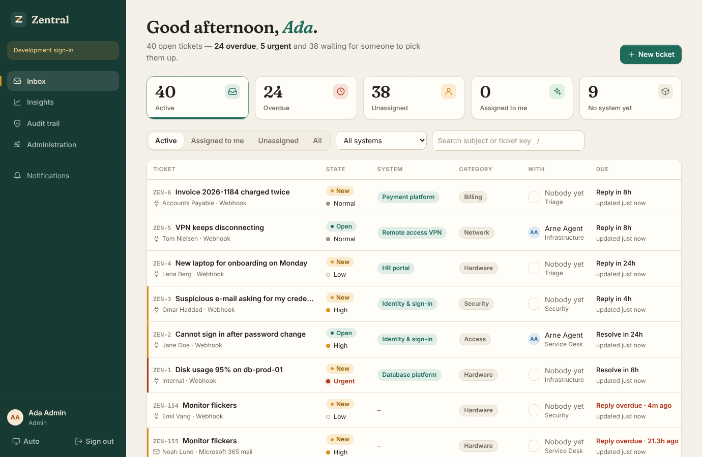

# Zentral

**A service desk built for private data.** Issues arrive from e-mail, Microsoft
Teams and your own systems; AI that can run entirely on your hardware triages
them; people and AI agents work them under one identity, one permission model
and one tamper-evident audit trail.



| | |
|---|---|
| **Channels** | Microsoft 365 mail, Microsoft Teams, signed webhooks for services — and a small plug-in contract for more (a Slack example is included) |
| **Systems** | Every ticket is linked to the business system it concerns; the link can come from the sender, the channel, AI, a rule or a person |
| **AI triage** | Category, priority, system and summary. On-prem models via the OpenAI-compatible protocol; personal data masked first; the model suggests, deterministic rules act |
| **AI agents** | Built-in MCP server with a least-privilege role |
| **Identity** | Microsoft Entra ID, or any OpenID Connect provider — per installation, by configuration |
| **Compliance** | RBAC with team scoping and segregation of duties, field-level encryption, hash-chained audit trail, GDPR export / erasure / retention |

## Quick start (development)

```bash
uv sync && (cd web && npm ci && npm run build)
uv run zentral init --auth dev && echo "ZENTRAL_STATIC_DIR=web/dist" >> .env
uv run zentral db upgrade && uv run zentral doctor
uv run zentral serve      # terminal 1 → http://localhost:8000
uv run zentral worker     # terminal 2
uv run python scripts/seed_demo.py
```

Development sign-in lets you pick a persona. Never expose it to a network.

## Documentation

The full documentation is a MkDocs site in [`docs/`](docs/index.md):

```bash
uv sync --group docs && uv run mkdocs serve
```

| | |
|---|---|
| Start | [Getting started](docs/getting-started.md) · [Design principles](docs/design-principles.md) · [Roadmap](docs/roadmap.md) |
| How it works | [Overview](docs/processes/index.md) · [Intake](docs/processes/intake.md) · [Triage](docs/processes/triage.md) · [Lifecycle](docs/processes/lifecycle.md) · [Access](docs/processes/access.md) · [Personal data](docs/processes/data.md) · [Oversight](docs/processes/oversight.md) · [User stories](docs/processes/user-stories.md) |
| Architecture | [Overview](docs/architecture/overview.md) · [Security](docs/architecture/security.md) · [Threat model](docs/architecture/threat-model.md) · [AI pipeline](docs/architecture/ai.md) |
| Use | [Agents](docs/guides/agents.md) · [Administration](docs/guides/administration.md) · [Systems](docs/guides/systems.md) · [MCP](docs/guides/mcp.md) · [API](docs/guides/api.md) |
| Operate | [Deployment](docs/operations/deployment.md) · [Trial on a VPS](docs/operations/deploy-trial.md) · [Compose](docs/operations/deploy-compose.md) · [Kubernetes](docs/operations/deploy-kubernetes.md) · [Entra ID](docs/operations/identity-entra.md) · [Other OIDC](docs/operations/identity-oidc.md) · [Runbooks](docs/runbooks/index.md) |
| Comply | [GDPR](docs/compliance/gdpr.md) · [Roles and permissions](docs/compliance/rbac.md) · [Logging and audit](docs/compliance/logging.md) |
| Extend | [Connectors](docs/extending/connectors.md) · [AI providers](docs/extending/ai-providers.md) · [Authentication](docs/extending/authentication.md) |

## Status

Early software. The security controls are implemented and covered by an
automated test suite, but Zentral has **not** been independently
penetration-tested or certified, and several integrations have only been tested
against stubs. Read [Security posture](docs/compliance/security-posture.md) —
it lists exactly what is and is not verified, and what to do before go-live.

## Development

```bash
uv run pytest                 # backend tests (SQLite)
uv run ruff check . && uv run mypy
(cd web && npm test)
```

See [Local setup](docs/development/setup.md), [Testing](docs/development/testing.md)
and [Contributing](docs/development/contributing.md). Report vulnerabilities
privately — see [SECURITY.md](SECURITY.md).
