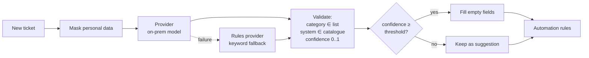

# AI pipeline

AI in Zentral does one job: look at a new ticket and **suggest** a category, a
priority, the affected system and a one-sentence summary. It runs in the
worker, after the ticket is safely stored.

## The contract



A provider receives the ticket's subject, the first message (max 8,000
characters), the list of allowed categories and the active systems (key, name,
description). It returns exactly:

```json
{"category": "access", "priority": "high", "system": "identity",
 "summary": "User is locked out after a password change.", "confidence": 0.9}
```

## Safety properties

These hold for every provider, and each is covered by a test.

**1. The model cannot act.** It has no tools and no way to call anything. Its
only output is the object above.

**2. Output is never trusted.** A category outside the configured list becomes
`other` with confidence 0. A system outside the catalogue is dropped.
Confidence is clamped to 0–1. The summary is reduced to one plain line.

**3. Prompt injection has nowhere to go.** Ticket text is wrapped in tags and
declared untrusted in the system prompt — but the design does not *rely* on
the model obeying. Even a fully hijacked model can only return a wrong label,
which a human sees and can correct.

**4. Suggestions fill gaps; they never overwrite people.** A category, priority
or system chosen by a person (or supplied by the sender or channel) stays.

**5. Low confidence is only a suggestion.** Below `ZENTRAL_AI_MIN_CONFIDENCE`
(default 0.6) nothing is applied; the UI shows the suggestion with a "?" and an
*Apply* button.

**6. Personal data is masked first.** E-mail addresses, phone numbers, card and
IBAN numbers, national IDs, IP addresses, URLs and anything after
"password:" are replaced with placeholders such as `[EMAIL]` before the text
leaves the process. This is on by default and cannot be turned off for a cloud
provider in production.

**7. Intake never depends on AI.** If the provider errors, times out or returns
something unusable, the built-in keyword classifier is used instead and the
audit event records `fallback: true`.

**8. Every classification is audited**: provider, model, on-prem or not,
whether input was masked, the result, whether it was applied.

!!! warning "Masking is best effort"
    The redactor recognises *patterns*. It will not catch a name written in a
    sentence. That is why production data should go to an on-prem model, where
    the question of what leaves your network does not arise.

## Providers

| Provider | Where data goes | Use for |
|---|---|---|
| `rules` (default) | Nowhere — keyword matching in-process | No AI, or fallback |
| `openai_compatible` | A model you host: Ollama, vLLM, llama.cpp, LocalAI, TGI | **Production** |
| `anthropic` | Anthropic API (masked text) | Evaluation with test data |
| `claude_cli` | Claude via the local CLI and a Claude subscription | Local testing only; refused in production |

The on-prem provider speaks the OpenAI-compatible chat-completions protocol
with a JSON schema, which every common model server implements. Switching is a
configuration change: [Switch to on-prem AI](../runbooks/switch-to-on-prem-ai.md).

## Choosing an on-prem model

Triage is an easy task for a language model: a 7–8 B-parameter instruction
model (for example Llama 3.1 8B, Mistral 7B, Qwen 2.5 7B) on a single modest
GPU, or CPU with patience, is a reasonable starting point. Measure on your own
tickets before deciding — the live test in `tests/test_ai.py` shows how.

## Automation rules

After classification, enabled rules run in order. A rule has conditions
(all must match) and actions:

| Conditions | Actions |
|---|---|
| category, priority, channel, source, **system**, subject contains | route to team, set priority, **set system**, assign, add tags, stop |

Rules can only route and label. They cannot send messages or delete anything,
so a wrong classification can misroute a ticket but cannot cause an outbound
effect.

## AI agents are a separate thing

The classifier above is built in and has no agency. *AI agents* — external
programs that connect over [MCP](../guides/mcp.md) — are ordinary API clients
with an identity, roles and an audit trail.
