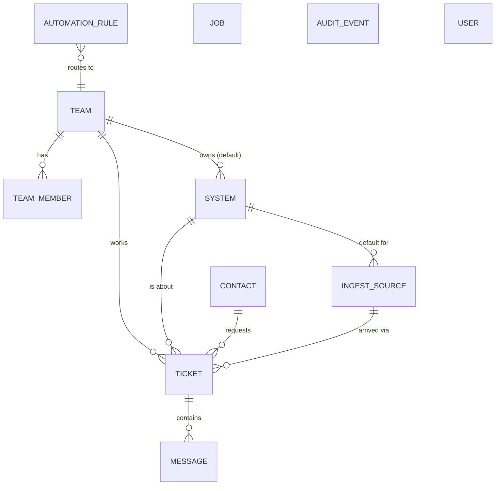
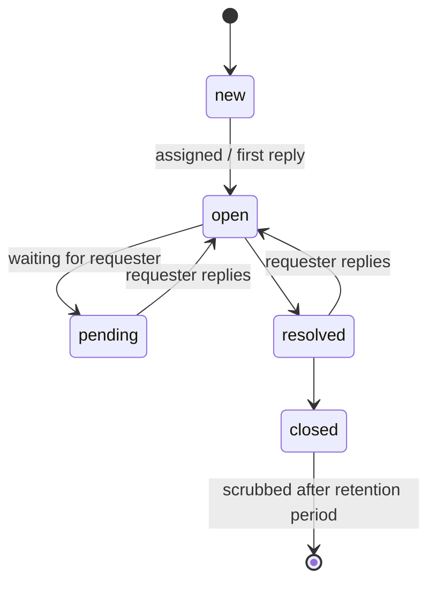

# Data model

## Tables

| Table | Purpose | Personal data |
|---|---|---|
| `tickets` | One issue. Status, priority, category, tags, team, assignee, **system**, AI suggestions. | `subject`, `ai_summary`, `thread_ref` — **encrypted** |
| `messages` | Conversation entries: `inbound` (from requester), `outbound` (to requester), `note` (internal). | `body` — **encrypted** |
| `contacts` | Requesters (data subjects). | `email`, `display_name` — **encrypted**; `identity_hash` — blind index |
| `systems` | The catalogue of business systems tickets can concern. | none |
| `teams`, `team_members` | Queues and who works them. | staff object IDs |
| `users` | Staff and service principals, mirrored from token claims at sign-in so they can be shown as assignee/author. | staff name and e-mail (clear text) |
| `ingest_sources` | Configured channels. | `secrets` — **encrypted**; `token_hash` — SHA-256 only |
| `automation_rules` | Deterministic routing rules. | none |
| `jobs` | Background work queue. | IDs only |
| `audit_events` | Append-only audit trail. | actor IDs, IP address; never content |

## How personal data is stored

**Encrypted columns** use Fernet (AES-128-CBC with HMAC-SHA256, authenticated)
with a key ring: the first key in `ZENTRAL_ENCRYPTION_KEYS` encrypts, all keys
decrypt, so keys rotate without downtime
([runbook](../runbooks/key-rotation.md)).

**Blind indexes.** Some encrypted values must be *found* — "which contact has
this e-mail address?", "have we seen this message ID?". For those, Zentral
stores a keyed hash (HMAC-SHA256 with `ZENTRAL_BLIND_INDEX_KEY`) next to the
ciphertext. Equality lookups work; the value cannot be read back or guessed
without the key.

| Column | Indexes |
|---|---|
| `contacts.identity_hash` | `email:<address>`, `teams:<object id>`, `slack:<user id>` |
| `messages.external_id` | the channel's message ID (de-duplication) |
| `tickets.external_thread_id` | the channel's conversation ID (threading) |

**What is deliberately not encrypted:** status, priority, category, tags,
timestamps, team and system links, and staff names. These are needed for
filtering and sorting and are not requester personal data. Tags are restricted
to a safe character set but are free text — instruct staff not to put names in
them.

!!! note "Trade-off: search"
    Because subjects are encrypted, the database cannot search them. Free-text
    search decrypts in the application over the 1,000 most recent tickets the
    caller may see. See [ADR 4](decisions.md).

## Ticket lifecycle

A requester's reply to a **closed** ticket opens a new ticket; closed tickets
are never reopened.

## Schema changes

Schema changes are Alembic migrations in `src/zentral/migrations/versions`,
applied with `zentral db upgrade`. A test fails if the models and migrations
drift apart, and `/readyz` reports *not ready* until the database is at the
revision the running version expects.
