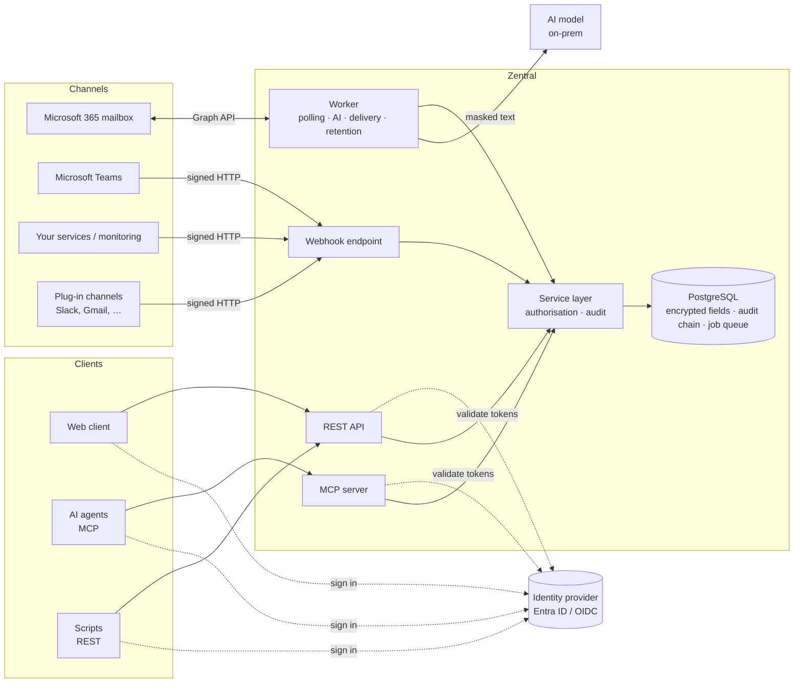
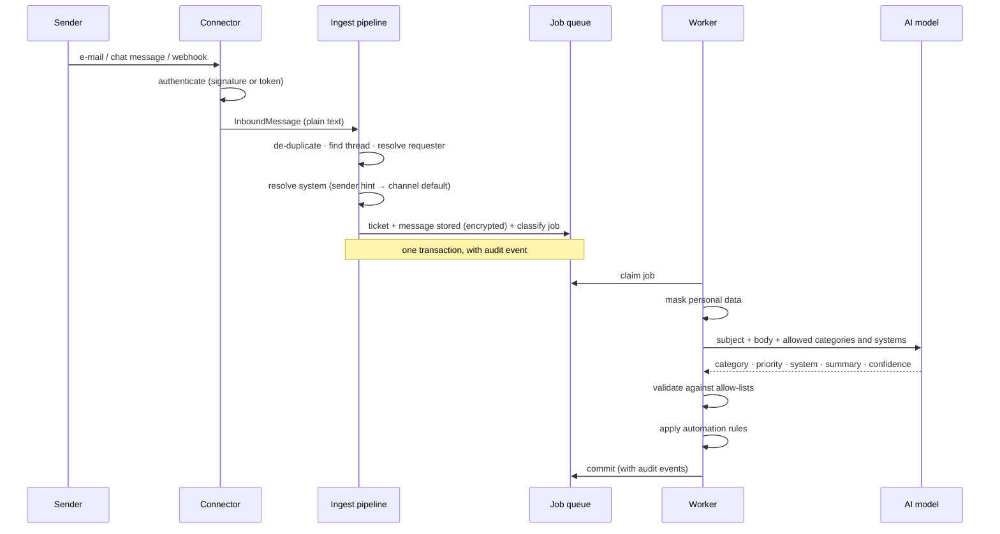

# Architecture overview

## Components

| Component | What it does | Code |
|---|---|---|
| **API server** | REST API, MCP endpoint, webhook endpoint and the static web client, in one ASGI process. Stateless. | `zentral/api`, `zentral/mcp_server.py` |
| **Worker** | Processes the job queue: mailbox polling, AI classification, reply delivery, retention sweeps. | `zentral/services/jobs.py` |
| **Service layer** | Every operation on tickets, systems, teams, channels, privacy. All authorisation and audit happens here. | `zentral/services` |
| **Connectors** | Adapt one external channel to the normalised message model. Plug-ins. | `zentral/connectors` |
| **AI providers** | Turn a (masked) ticket into a category/priority/system suggestion. Plug-ins. | `zentral/ai` |
| **Security core** | Token validation, RBAC, field encryption, redaction. | `zentral/security` |
| **Audit trail** | Hash-chained, append-only event log. | `zentral/audit` |
| **Web client** | React single-page app; talks only to the REST API. | `web/` |

The server and the worker are the same container image started with different
commands (`zentral serve`, `zentral worker`).

## A request, step by step

Every authenticated call — from a browser, a script or an AI agent — follows
the same path:

1. **Edge hardening** — host check, body-size limit, security headers, a
   server-generated request ID.
2. **Authentication** — the bearer token is validated against the identity
   provider's keys and turned into a *principal* (subject, roles, groups).
3. **Rate limit** per principal.
4. **Unit of work** — a database transaction is opened; the principal's team
   memberships are resolved.
5. **Service call** — the service function checks permissions and team scope,
   does the work, and queues audit events (and background jobs) in the same
   transaction.
6. **Commit** — the audit events are appended to the hash chain and committed
   *together with* the change. If either fails, both roll back.

Denied attempts are recorded in a separate transaction, because the original
one is rolled back.

## How a message becomes a ticket

Details: [AI pipeline](ai.md), [Systems catalogue](../guides/systems.md).

## Background jobs

There is no message broker. Jobs are rows in the `jobs` table, written in the
same transaction as the change that needs them (a *transactional outbox*), so
"ticket saved but classification never queued" cannot happen. Workers claim
jobs with `SELECT … FOR UPDATE SKIP LOCKED`, which makes it safe to run several
workers. Delivery is at-least-once; handlers are idempotent. Failed jobs are
retried with exponential backoff, five times.

| Job | Trigger |
|---|---|
| `classify_ticket` | A new ticket |
| `send_message` | An agent replies on a ticket whose channel can deliver |
| `poll_source` | Every `ZENTRAL_POLL_INTERVAL_SECONDS` per polling channel |
| `retention_sweep` | Every six hours |

## Scaling and availability

- The API server is stateless; run two or more behind a load balancer.
- Several workers can run concurrently.
- PostgreSQL is the single stateful component: its availability and backups
  are the installation's availability and backups.
- The in-process rate limiter is per replica; put global limits in your
  gateway or WAF.

## Technology

Python 3.12+, FastAPI, SQLAlchemy 2 (async), PostgreSQL 14+, Alembic, PyJWT,
`cryptography`, the official MCP SDK, structlog. Web: React 19, TypeScript,
Vite — and no other runtime dependency.
