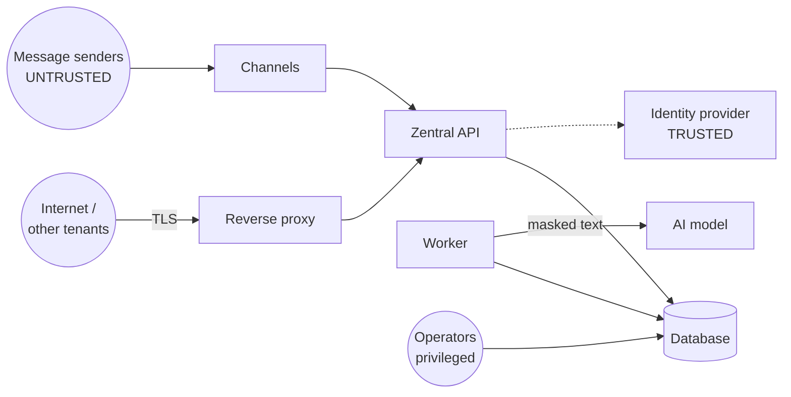

# Threat model

A structured view of who might attack Zentral, what they would want, and what
stands in the way. Use it as the starting point for your own risk assessment
and DPIA — your deployment adds context this page cannot know.

## Assets

1. **Ticket content and requester identities** (personal data, possibly
   special categories — people write anything into a support request).
2. **The audit trail** (evidence).
3. **Keys and channel secrets.**
4. **The ability to act as the service desk** (send messages, route work).

## Trust boundaries

Trusted: the identity provider, the operators holding the keys, the host
platform. Untrusted: everyone who can send a message, every authenticated user
beyond their role, any AI model's output.

## Threats and mitigations

### Outsiders

| Threat | Mitigation | Residual risk |
|---|---|---|
| Forge or replay an access token | Signature, issuer, audience, expiry, algorithm allow-list; tests cover `alg=none`, HMAC key-confusion, wrong key, wrong tenant | Compromise of the identity provider itself |
| Guess or steal a webhook token | 256-bit random, stored hashed, constant-time comparison, rate limit, rotation endpoint | Token leaked by the sending system — scope is one channel, create-only |
| Forge a Teams/Slack request | HMAC verification; Slack timestamp window; de-duplication by event ID | Secret leaked by the platform admin |
| Spoof an e-mail sender | Out of Zentral's control: rely on SPF/DKIM/DMARC enforcement in Exchange. Threading requires sender = requester | A spoofed sender can open tickets and append to their "own" |
| Find out whether someone is a requester (portal) | Same answer for every address; links created and sent by the worker, not in the request; attempts audited without the address | — |
| Steal or replay a portal link | Single use, 15 minutes, only the hash stored, kept out of server logs and history (URL fragment, removed on arrival), rate-limited per address | Someone who can read the requester's mailbox — the same exposure as e-mail itself |
| Hijack or forge portal requests (CSRF, XSS) | HttpOnly SameSite=Strict cookie scoped to the portal API; mandatory custom header; strict CSP; server-side sessions revoked on sign-out and erasure | Browser zero-day |
| Use a portal session to reach staff data | Requesters hold no permission; every portal call checks ticket ownership; notes, AI output and staff names are never in portal responses; staff tokens and portal cookies are not interchangeable | — |
| Upload malware or a script disguised as an image | Type judged by content against an allow-list (no SVG/HTML/Office/executables); malware scan before anyone can open; downloads only, with `sandbox` CSP and `nosniff` | Zero-day malware unknown to the scanner |
| Leak location or identity through file metadata | EXIF/XMP/IPTC/comments and PNG text chunks stripped before storage | Information visible *in* the picture |
| XSS via ticket content | Text-only storage and rendering; strict CSP | Browser zero-day |
| Enumerate tickets or channels | Uniform `404`/`401`; server-side scope filter | — |
| Denial of service | Size limits, rate limits, bounded queries, linear-time text matching, throttling of repeated bad tokens | Volumetric attacks: needs an upstream WAF/CDN |

### Malicious message senders

| Threat | Mitigation |
|---|---|
| Prompt injection ("ignore your instructions and…") | The model has no tools; output is validated against allow-lists; actions come from deterministic rules. Worst case: a wrong label |
| Trick an AI *agent* reading tickets over MCP | Server instructions and tool descriptions mark content as untrusted; the recommended agent role cannot see personal data or contact requesters; everything is audited. **The agent's own guardrails remain the operator's responsibility** |
| Inject into someone else's ticket by guessing its key | Key threading requires the sender to be that ticket's requester |
| Flood the desk with duplicates | Idempotent ingestion; thread keys collapse repeated alerts |
| Use acknowledgements as a spam relay (backscatter) | The receipt carries only the ticket key — no content, no attacker-controlled text; sent once per new ticket, never to automatic mail; limited by the channel's allowed recipient domains; can be turned off per channel |

### Insiders

| Threat | Mitigation |
|---|---|
| Agent browses tickets of other teams | Team scope; out-of-scope attempts audited |
| Curious read of a specific person's tickets | Every read of content is audited with actor and time; lookup by e-mail needs `ticket:read_pii` |
| Admin quietly exports personal data | Admin role has no export/erase permission (segregation of duties); privacy operations are audited |
| Someone edits the audit trail | Hash chain (keyed) + database triggers; verification detects edits, deletions, reordering |
| Over-privileged service identity | Narrow roles (`Zentral.Ingest`, `Zentral.Automation`); per-channel tokens |
| Mail connector credentials used to read other mailboxes | The connector proves its access is limited to its mailbox before reading, hourly; refuses to run otherwise |

### Infrastructure compromise

| Threat | Mitigation | Residual risk |
|---|---|---|
| Database dump / backup stolen | Field encryption: content unreadable without keys | Metadata (status, timestamps, team/system links, staff names) is readable |
| Database write access | Audit triggers + keyed chain make tampering detectable | Data destruction: rely on backups |
| Configuration, environment or secret store leaked (manifests, `.env`, CI variables, orchestrator secrets, configuration backups) | With a [key provider](../operations/key-custody.md), no key is in any of them: the keyring is useless without the KMS key, and production refuses plain-text keys unless explicitly allowed | With `ZENTRAL_ALLOW_ENV_KEYS=true`: the leak exposes the keys (doctor warns) |
| Application host compromised | Non-root, read-only filesystem, no capabilities, network policies. Keys come from an envelope-encrypted keyring unwrapped by Key Vault / Managed HSM / Vault Transit; the app's identity can only unwrap; every unwrap is logged by the KMS and access can be revoked at once | **An attacker controlling the running process can read keys from its memory**, as the process must hold them to encrypt and decrypt (the audit HMAC is in-process too, for latency). Revoking unwrap stops new processes, not a live one: rotate the data and audit keys afterwards |
| Malicious dependency or plug-in | Lock files with hashes, audits, plug-in allow-list | Supply-chain attacks on a pinned dependency |
| AI provider retains data | On-prem provider keeps data inside your network; cloud providers receive masked text only and are refused unmasked in production | Pattern-based masking is best effort — names in free text can pass |

## What is explicitly out of scope today

Stated plainly so nobody assumes otherwise:

- **Attachment scanning** is as good as ClamAV's signatures; a novel threat in
  a PDF can pass. PDFs are offered as downloads only, never rendered by Zentral.
- **No built-in WAF, DDoS protection or intrusion detection.**
- **Keys in process memory.** Envelope encryption keeps keys out of
  configuration and storage, but not out of the running process; per-field
  HSM operations are not used.
- **Masking is pattern-based**, not anonymisation.
- **No independent penetration test or certification** has been performed.
