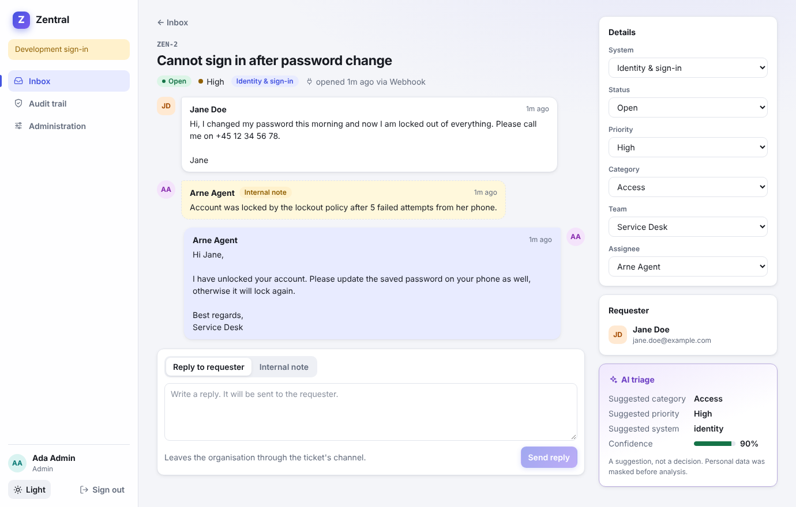
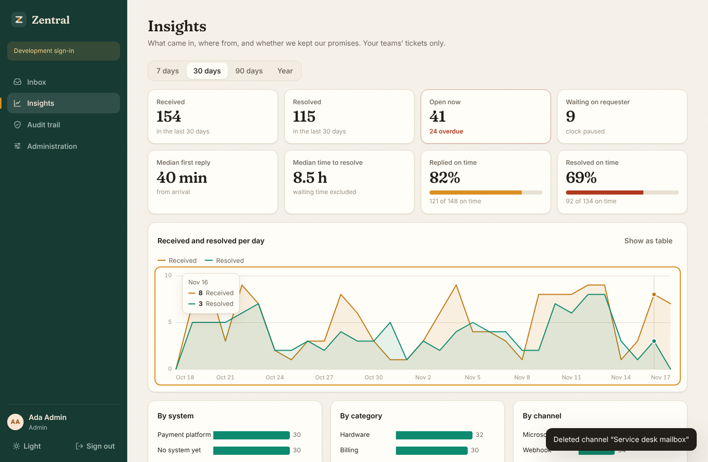

# Working tickets

For service-desk agents. You need the **Agent** role and membership of at
least one team.

## The inbox

The cards at the top are live counts for *your* scope and double as filters:

| Card | Shows |
|---|---|
| **Active** | Everything new, open or pending |
| **Overdue** | Active tickets past a response or resolution target |
| **Unassigned** | Nobody has picked these up |
| **Assigned to me** | Your own queue |
| **No system yet** | Tickets nobody has linked to a system |

Below, filter by **system**, switch tabs, or search. Press ++slash++ to jump to
the search box. Search matches the subject or a ticket key (`ZEN-42`) among the
1,000 most recent tickets you can see.

You see tickets that belong to **your teams**, tickets **assigned to you**, and
**untriaged** tickets (no team yet). You cannot see other teams' tickets — not
by guessing a link either.

A coloured bar on the left of a row marks high (amber) and urgent (red)
priority. The **Due** column shows the next target: time left, or how late it
is. It is empty while a ticket is *pending* — the clock is paused. A purple label ending in "?" is an AI suggestion that has not been
applied.

## Working a ticket

- **Take it**: set *Assignee* to yourself. A new ticket becomes *open*.
- **Say which system it is about**: the *System* field. If AI suggested one,
  use *Set system to …* in the AI triage card.
- **Reply to requester** sends your message through the channel the ticket
  came from (e-mail, Teams, …). Its delivery status appears on the message.
- **Internal note** is visible to staff only and never leaves the service desk.
  The composer turns yellow so you cannot confuse the two.
- **Status**: *pending* while you wait for the requester (their reply reopens
  it), *resolved* when done. A reply to a resolved ticket reopens it; a reply
  to a closed ticket starts a new one.
- **Route**: change *Team* to hand the ticket to another queue. You keep access
  while it is assigned to you.
- **Tags**: add short labels under *Details*. Tags are not encrypted, so never
  use names or addresses.
- **Activity** shows what happened to the ticket and who did it — changes,
  notes, replies, AI triage. It does not show who merely looked.

- **Saved replies**: pick one from *Saved replies…* under the composer. It is
  filled in with the requester's first name, the ticket key and your name, and
  you can edit it before sending — nothing is sent until you press send.
- **Merge a duplicate**: on the duplicate, open *Merge a duplicate* and enter
  the key of the ticket to keep. The conversation moves there and the duplicate
  closes; later replies to it land on the kept ticket. Only tickets from the
  same requester can be merged, and it cannot be undone.

Handy to know: ++ctrl+enter++ sends. Text you have not sent yet is kept while
you look at another ticket (in memory only — it is gone when you close the
tab). When the queue changes while you are in the inbox, a banner offers the
latest view.

## Targets

Every ticket has two targets, set from its priority:

- **First response** — the first reply to the requester. An automatic
  acknowledgement does not count; a person must answer.
- **Resolution** — the ticket is resolved. Time spent *pending* (waiting for
  the requester) does not count.

The *Targets* panel on a ticket shows both: met, late, due in…, or breached.
Changing the priority moves the targets. How the clock works is drawn out in
[Ticket lifecycle](../processes/lifecycle.md).

A resolved ticket that nobody reopens is closed automatically after a few
days (7 by default). A reply after that starts a new ticket.

## Insights

**Insights** in the sidebar shows how the desk is doing over the last 7–365
days: tickets received and resolved, open and overdue now, median times, how
many met their targets, and where the work comes from (system, category,
channel, priority). It counts only tickets you could open, and it shows
numbers, never content. Switch the chart to a table with *Show as table*.

## The AI triage card

It shows what the model suggested and how confident it was. Suggestions with
high confidence are applied automatically to fields nobody had set; you can
always change them. The model saw a version of the text with personal
identifiers masked, and it cannot do anything except suggest.

## Good practice with personal data

- Everything you open is recorded in the audit trail with your name and the
  time. That protects you as much as the requester.
- Do not copy ticket content into chat tools, documents or other AI assistants.
- Do not put names or e-mail addresses in **tags** — tags are not encrypted.
- If a requester asks what you hold about them or wants it deleted, do not try
  to handle it yourself: pass it to your privacy officer
  ([Privacy requests](privacy-officer.md)).

## Appearance

Use the theme button at the bottom of the sidebar to switch between automatic
(follows your device), light and dark.
