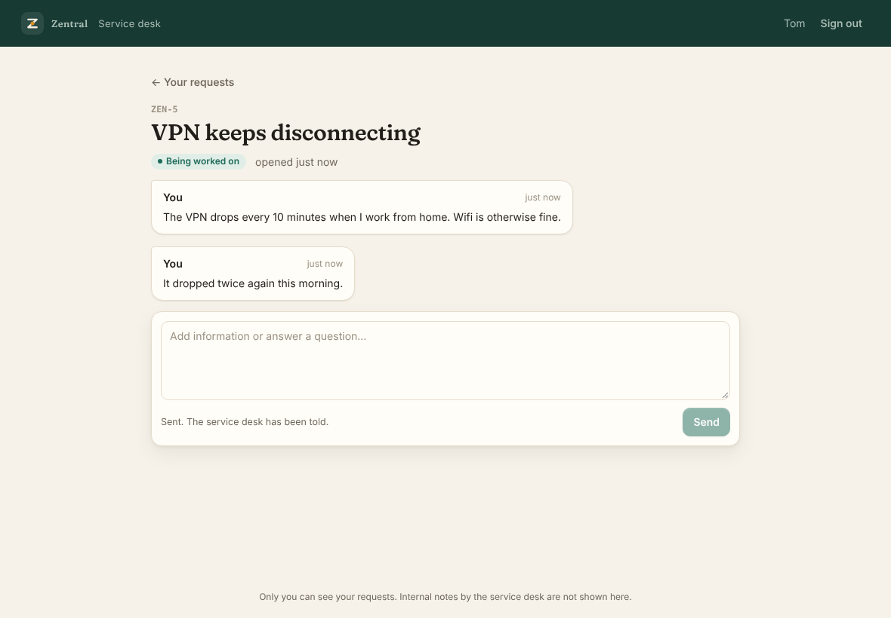
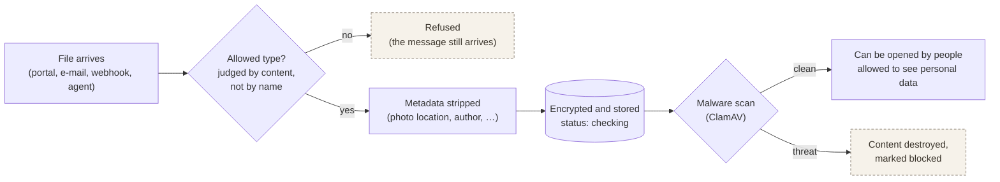

# Attachments and screenshots

Requests often need a picture: an error dialog, a broken page, a log file.
Zentral accepts them from every door — the requester portal, e-mail (including
screenshots pasted into the mail), webhooks from your own apps, and agents —
and treats every file as hostile until proven otherwise.



## The life of a file



| Rule | Why |
|---|---|
| **Only images (PNG, JPEG, GIF), PDF and plain text.** The type is read from the file's first bytes; the name and the declared type are ignored | SVG and HTML can run scripts; Office files can carry macros; a `.png` that is really a program is refused |
| **Metadata is removed from images before storing** — EXIF (including GPS location), XMP, IPTC, comments and PNG text chunks | A phone photo reveals where it was taken and on which device; nobody meant to send that |
| **Encrypted at rest**, like ticket text, and re-encrypted by key rotation | A stolen database or backup reveals nothing |
| **Nobody can open a file before the malware scanner cleared it.** A file with a threat is destroyed; the record and audit event remain | An infected file never reaches an agent's machine |
| **Opening needs `ticket:read_pii`**, and is audited. Roles without it see that there is a file, not its name or content | A screenshot cannot be masked |
| **AI never sees files**: not the classifier, not AI agents over MCP | Data minimisation |
| **Files are downloads, never pages**: `Content-Disposition: attachment`, `sandbox` CSP, `nosniff` | Even a crafted PDF cannot run in Zentral's origin |
| Names are cleaned (no paths, no control or direction-override characters) and the extension is set from the real type | `invoice.pdf.exe` cannot pretend |

Requesters see the files *they* sent in the portal; files an agent attaches are
internal, like notes. Files go with the ticket's content under the
[retention policy](../processes/data.md#retention) and on erasure, are
included (the requester's own) in a data-subject export, and move along when
tickets are merged.

## Turning it on

Attachments are off until a scanner is in place.

=== "Docker Compose"

    ```bash
    # .env
    ZENTRAL_ATTACHMENTS_ENABLED=true
    docker compose --profile attachments up -d   # starts ClamAV next to Zentral
    ```

=== "Kubernetes"

    Run `clamav/clamav` as a Deployment with a Service named `clamav` on port
    3310 (it needs outbound access for signature updates), then set
    `ZENTRAL_ATTACHMENTS_ENABLED=true`. Point `ZENTRAL_CLAMAV_HOST` /
    `ZENTRAL_CLAMAV_PORT` elsewhere if needed.

| Setting | Default | Meaning |
|---|---|---|
| `ZENTRAL_ATTACHMENTS_ENABLED` | `false` | Accept files at all |
| `ZENTRAL_ATTACHMENT_MAX_BYTES` | 10 MiB | Largest file (up to 25 MiB) |
| `ZENTRAL_ATTACHMENTS_PER_TICKET` | 20 | Most files on one ticket |
| `ZENTRAL_ATTACHMENT_SCANNER` | `clamav` | `none` is for development only and is refused in production |

If the scanner is down, files wait (status *checking*) and are retried; they are
never opened unscanned. The mail channel has its own switch, *Keep attached
files*, if one mailbox should not take files.

## For agents

- Files appear under the message they came with; images show a preview — click
  it to enlarge, click the name to download.
- **Attach file** under the composer, or **paste a screenshot** (Ctrl+V) into
  it. Files you attach are internal notes: they are never sent to the
  requester.
- "Checking for malware…" turns into the file within seconds; "Blocked" means
  the scanner found a threat and the content is gone.
