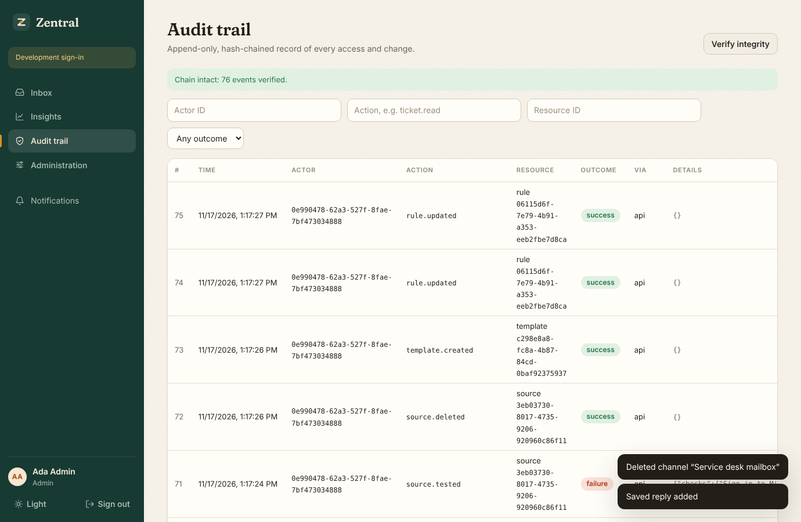

# Auditing

For holders of the **Auditor** role. You can read and verify the audit trail.
You cannot see ticket content — by design, auditing access does not require
access to the data.

## What is recorded

One event per action, including reads and refused attempts:

| Field | Meaning |
|---|---|
| `#` (seq) | Position in the chain; gap-free |
| Time | UTC |
| Actor | Directory object ID of the person or service; `system:worker` for background work |
| Action | e.g. `ticket.read`, `ticket.updated`, `privacy.erased`, `access.denied` |
| Resource | Type and ID |
| Outcome | `success`, `denied`, `failure` |
| Via | `api` (web/REST), `mcp` (AI agent), `hook` (inbound channel), `worker`, `cli` |
| Details | Field names and enumerated values; **never** content or addresses |

The full list of actions is in [Logging and audit](../compliance/logging.md#actions).

## Answering typical questions

| Question | Filter |
|---|---|
| Who opened ticket 4711? | Resource ID `4711`, actions `ticket.read` / `ticket.messages.read` |
| What did this person do last week? | Actor ID |
| Were there access attempts that were refused? | Outcome *Denied* |
| Who erased personal data, and when? | Action `privacy.erased` |
| What did the AI agent do? | Actor ID of the agent's service principal — all events have *Via* `mcp` |
| Who changed the channel configuration? | Action `source.updated` |

To map an actor ID to a name, look the object ID up in your identity provider.
Zentral deliberately keeps names out of the trail.

## Verifying integrity

*Verify integrity* recomputes the whole chain. Each event's hash covers its
content and the previous event's hash, keyed with a secret only the application
holds, so any edit, deletion or reordering — even by someone with direct
database access — breaks the chain at that point.

- **Chain intact: N events verified** — the trail is exactly as written.
- **Tampering detected at event #N** — everything before N is trustworthy;
  from N on, treat as compromised and start the
  [security incident runbook](../runbooks/security-incident.md).

Your verification is itself recorded. For scheduled verification and exports
to an archive, see the [audit runbook](../runbooks/audit-verification.md).

## Limits to be aware of

- The trail records what happened **through Zentral**. Direct database access
  by an operator is outside it — review database and platform logs for that.
- Authentication *failures* (invalid tokens) are in the operational log, not
  the audit trail, because they have no identified actor.
- IP addresses are those seen by the application; behind a proxy they are only
  meaningful if forwarding is configured correctly.
