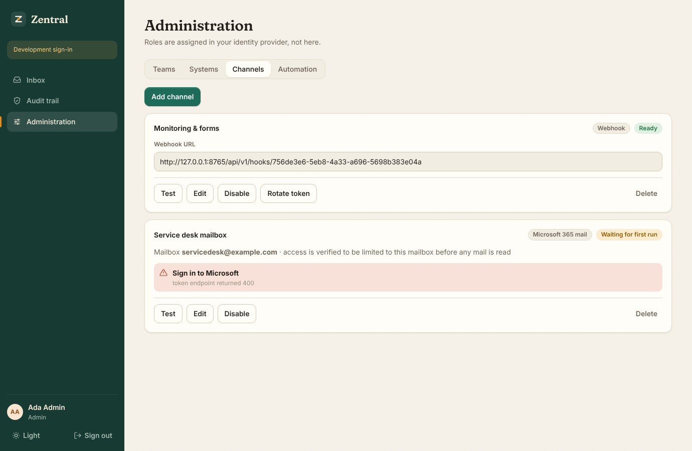
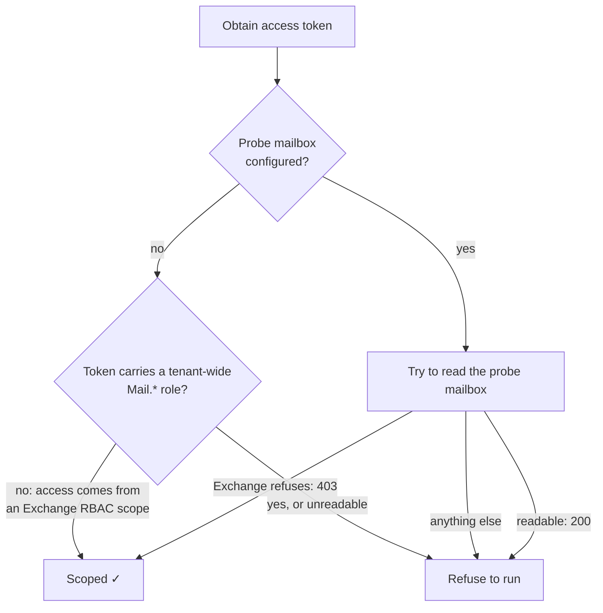

# E-mail (Microsoft 365)

Zentral reads a shared mailbox through Microsoft Graph and sends agents'
replies from the same mailbox.

!!! success "Scoped by construction"
    Graph application permissions are tenant-wide unless restricted. Zentral
    does not take that on trust: **before it reads any mail it proves that its
    credentials cannot reach other mailboxes**, and it repeats the proof every
    hour. If the proof fails, the channel reads nothing and shows why. There is
    no setting to turn this off. [How the check works](#how-the-scope-check-works).

## 1. A mailbox

Create a shared mailbox, e.g. `servicedesk@example.com`. Make sure your
anti-spoofing policy (SPF, DKIM, DMARC enforcement) applies to it — Zentral
trusts the sender address Exchange reports.

## 2. An app registration for the connector

Use a **dedicated** app registration (not the Zentral API one):

1. *Entra admin center → App registrations → New registration*, single tenant.
2. *Certificates & secrets → New client secret*. Note the value, the
   application (client) ID and the tenant ID.

Do **not** add Microsoft Graph mail permissions here. Access is granted in
Exchange in the next step, limited to one mailbox.

## 3. Grant access to exactly one mailbox

=== "RBAC for Applications (recommended)"

    ```powershell
    Connect-ExchangeOnline

    New-ServicePrincipal -AppId <APP_CLIENT_ID> -ObjectId <ENTERPRISE_APP_OBJECT_ID> -DisplayName "Zentral mail"

    New-ManagementScope -Name "Zentral mailbox" `
      -RecipientRestrictionFilter "PrimarySmtpAddress -eq 'servicedesk@example.com'"

    New-ManagementRoleAssignment -App <APP_CLIENT_ID> -Role "Application Mail.Read" -CustomResourceScope "Zentral mailbox"
    New-ManagementRoleAssignment -App <APP_CLIENT_ID> -Role "Application Mail.Send" -CustomResourceScope "Zentral mailbox"
    ```

    | You want | Roles to assign |
    |---|---|
    | Read only (no replies from Zentral) | `Application Mail.Read` |
    | Read and reply | `Application Mail.Read`, `Application Mail.Send` |
    | Also mark ingested mail as read | `Application Mail.ReadWrite` instead of `Mail.Read` |

    Verify:

    ```powershell
    Test-ServicePrincipalAuthorization -Identity <APP_CLIENT_ID> -Resource servicedesk@example.com   # InScope: True
    Test-ServicePrincipalAuthorization -Identity <APP_CLIENT_ID> -Resource someone.else@example.com  # InScope: False
    ```

    With this method the app holds no tenant-wide permission at all, and
    Zentral can confirm that from the access token alone — no probe mailbox
    needed.

=== "Application access policy (legacy)"

    If your organisation still uses application access policies, the app has
    tenant-wide Graph permissions (`Mail.Read`, `Mail.Send`) that a policy
    narrows:

    ```powershell
    New-ApplicationAccessPolicy -AppId <APP_CLIENT_ID> -PolicyScopeGroupId servicedesk@example.com `
      -AccessRight RestrictAccess -Description "Zentral: service desk mailbox only"
    ```

    Zentral cannot see the policy, so you must give it a **scope probe
    mailbox**: the address of any *other* mailbox in the tenant. Zentral tries
    to read it and runs only if Exchange refuses.

Changes in Exchange can take up to an hour to apply.

## 4. The channel in Zentral

*Administration → Channels → Add channel*, type **Email graph**. The form is
generated from the connector's settings:

### Settings

| Setting | Default | Meaning |
|---|---|---|
| **Mailbox** | — | The shared mailbox to read |
| **Folder** | `inbox` | Well-known folder name or folder ID |
| **Scope probe mailbox** | *(none)* | A mailbox Zentral must *not* be able to read. Required with an application access policy; optional (extra assurance) with RBAC for Applications |
| **First synchronisation** | `new_only` | `new_only`: only mail arriving from now on. `all`: import everything already in the folder |
| **Allowed sender domains** | *(any)* | Accept mail only from these domains (subdomains included) |
| **Blocked senders** | *(none)* | Addresses or domains to ignore |
| **Ignore automatic replies** | on | Skip out-of-office replies, bounces, newsletters and bulk mail. Also prevents mail loops |
| **After ingestion** | `leave` | `leave`: the mailbox is never modified. `mark_read`: mark ingested mail as read (needs `Mail.ReadWrite`) |
| **Send replies** | on | Deliver agents' replies from this mailbox. Off = read-only channel (no `Mail.Send` needed) |
| **Allowed recipient domains** | *(any)* | Only send replies to these domains — e.g. your own, for an internal desk |
| **Save replies to Sent Items** | on | Keep a copy of sent replies in the mailbox |
| **Acknowledge new tickets** | on | Send the requester a short receipt with the ticket key. Needs *Send replies* |
| **Acknowledgement text** | *(built-in)* | Your own wording; `{ticket_key}` is replaced with the key. Plain text, no personal data |
| **Batch size** | 25 | Messages fetched per poll |

### Credentials

Tenant ID, client ID and client secret from step 2. They are encrypted before
storage and can never be displayed again. When editing a channel, leave a
credential empty to keep the stored value.

### Routing

Default team and default [system](../systems.md). A mailbox per system
(`payments-support@…`) is a clean way to set the system without AI.

## 5. Test it



Press **Test** on the channel. Zentral runs a live self-test:

| Check | Passes when |
|---|---|
| **Sign in to Microsoft** | The client credentials are accepted |
| **Mailbox scope** | Access is proven to be limited to this mailbox |
| **Read mailbox** | The folder can be listed |
| **Send replies** | Reported as *cannot be verified without sending* — reply on a test ticket to confirm |

Then send a mail to the mailbox. It becomes a ticket within
`ZENTRAL_POLL_INTERVAL_SECONDS` (default 60). The channel card shows *Healthy*
with the time of the last successful poll, or *Failing* with the reason.

## How the scope check works

Before every poll and every send (cached for one hour):



- A configured probe is always tested and always wins: if the probe mailbox is
  readable, the channel stops even if the token looks scoped.
- "Refuse to run" means **no mail is fetched and nothing is sent**. The channel
  shows the reason, the worker logs it, and one `source.failing` event is
  written to the audit trail.
- Because the check repeats hourly, someone later granting the app broader
  permissions stops the channel within the hour instead of silently widening
  what the service desk can read.

What the check cannot do: it proves that *other* mailboxes are out of reach as
observed through the token and (if configured) one probe. With RBAC for
Applications that is conclusive. With an access policy, the probe demonstrates
the policy for one mailbox — choose a probe that the policy must exclude.

## How it behaves

- **New mail** → new ticket; the body is stored as plain text.
- **Replies**: agents' replies are sent as `[ZEN-123] <subject>`. When the
  requester answers, the key in the subject threads it onto the ticket —
  *only if the sender is that ticket's requester*. Messages in the same
  Exchange conversation are threaded too.
- **Loop protection**: automatic replies and mail from the mailbox's own
  address are never ingested.
- **Skipped mail** (blocked sender, automatic reply) stays in the mailbox,
  unread, for a person to look at; Zentral moves past it.
- **Duplicates** are impossible: each message ID is ingested once.
- **Mark as read** happens only after the ticket is safely stored; if marking
  fails, the ticket still exists.
- **Acknowledgements** go only to genuinely new tickets — never to
  automatic replies, blocked senders or replies threaded onto an existing
  ticket — and only to recipients the *Allowed recipient domains* permit.
  Because a sender address can be forged, the receipt says nothing but the
  ticket key: someone who spoofs an address learns nothing, and the real owner
  gets one short, harmless message. For an internal desk, restrict *Allowed
  recipient domains* to your own.
- **Attachments are ignored** (they stay in the mailbox).

## Operations

- **Client secret expiry**: put the date in your calendar. *Edit* the channel,
  enter the new secret, leave the other credentials empty
  ([key rotation](../../runbooks/key-rotation.md#channel-secrets)).
- **Channel shows Failing**: the message says why — see
  [Troubleshooting](../../runbooks/troubleshooting.md#no-new-tickets-from-e-mail).
- **Network**: the worker needs outbound HTTPS to `login.microsoftonline.com`
  and `graph.microsoft.com`.
- **Retention**: Zentral never deletes from the mailbox. Apply an Exchange
  retention policy to it and include it in erasure requests.

## Other mail systems

Gmail, IMAP and others are not built in. The connector contract is small — see
[Write a connector](../../extending/connectors.md); the Graph connector
(`src/zentral/connectors/email_graph.py`) is the model for a polling connector,
including how to verify scope before reading.
