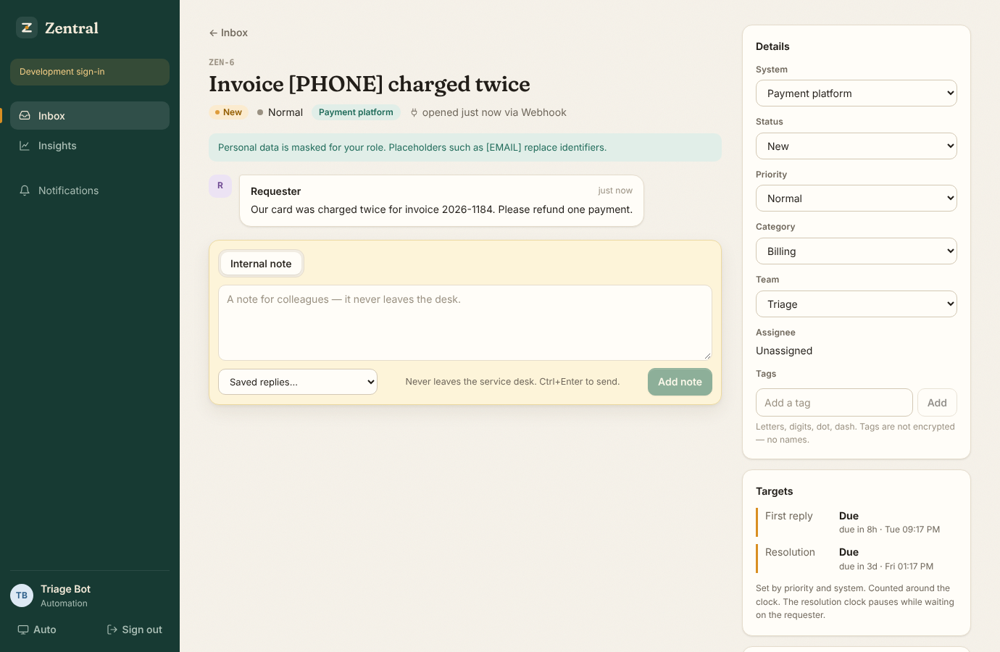

# AI agents over MCP

Zentral includes a [Model Context Protocol](https://modelcontextprotocol.io)
server so AI agents can work with tickets directly.

| | |
|---|---|
| **Endpoint** | `https://<your-host>/mcp` |
| **Transport** | Streamable HTTP, stateless, JSON responses |
| **Authentication** | `Authorization: Bearer <access token>` from your identity provider |
| **Discovery** | `/.well-known/oauth-protected-resource/mcp` (RFC 9728) |

An agent is an ordinary principal: it has an identity in your directory, roles,
team memberships and an audit trail. There are no MCP-specific credentials and
no separate permission system.



## Tools

| Tool | Does | Permission |
|---|---|---|
| `whoami` | Roles, permissions, teams; whether personal data is masked | — |
| `search_tickets` | List tickets by status, priority, category, team, system, text | `ticket:read` |
| `get_ticket` | One ticket with its conversation | `ticket:read` |
| `create_ticket` | Open an internal ticket | `ticket:create` |
| `update_ticket` | Status, priority, category, tags, system, team; assignee | `ticket:update` (`ticket:assign` for assignee) |
| `add_note` | Internal note | `ticket:note` |
| `reply_to_requester` | Send a message to the requester | `ticket:reply` |
| `merge_tickets` | Fold a duplicate into a ticket from the same requester | `ticket:update` |
| `list_saved_replies` | Saved replies to start from | `ticket:reply` or `ticket:note` |
| `get_insights` | Aggregates for the last N days: volumes, medians, targets met, breakdowns | `ticket:read` |
| `list_teams`, `list_systems`, `list_categories` | Reference data | `ticket:read` |

Tickets of people who [objected to AI processing](privacy-officer.md#objection-to-ai-processing-art-21)
are invisible over MCP, whatever role the agent has.

## Give the agent the least it needs

Use the **`Zentral.Automation`** role for autonomous agents:

- reads tickets with **personal data masked** — requester shown as
  "Requester 1a2b3c4d", identifiers replaced by `[EMAIL]`, `[PHONE]`, …;
- can triage: set category, priority, system, tags, route to a team, add notes;
- **cannot** see personal data, assign to a person, or send anything to a
  requester;
- sees untriaged tickets plus the teams you add it to — nothing else.

Give an agent `Zentral.Agent` only if a human reviews what it sends, and never
give an agent `Zentral.Admin`.

## Set up an agent identity

=== "Microsoft Entra ID"

    1. Register an application for the agent (*App registrations → New*).
    2. Under *API permissions → Add → My APIs → Zentral API → Application
       permissions*, add **Zentral.Automation** and grant admin consent.
    3. Create a client secret or, better, a certificate or federated credential.
    4. The agent obtains tokens with the client-credentials flow:

    ```bash
    curl -s -X POST "https://login.microsoftonline.com/$TENANT_ID/oauth2/v2.0/token" \
      -d grant_type=client_credentials \
      -d client_id=$AGENT_CLIENT_ID -d client_secret=$AGENT_SECRET \
      -d scope="api://$ZENTRAL_API_CLIENT_ID/.default" | jq -r .access_token
    ```

=== "Other OIDC providers"

    Create a confidential client with the client-credentials grant whose access
    token has Zentral's audience and carries `Zentral.Automation` in the roles
    claim (or a value you map with `ZENTRAL_ROLE_MAP`). See
    [Identity — other OIDC providers](../operations/identity-oidc.md#service-accounts).

=== "Local development"

    ```bash
    curl -s -X POST http://localhost:8000/api/v1/dev/token \
      -H 'Content-Type: application/json' -d '{"persona":"automation"}' | jq -r .access_token
    ```

After the agent's first call it appears under *Administration → Teams → Add
member*, so you can add it to the teams whose tickets it should see.

## Connect a client

Tokens expire (typically after an hour); the client or a small wrapper must
refresh them.

=== "Claude Code"

    ```bash
    claude mcp add --transport http zentral https://servicedesk.example.com/mcp \
      --header "Authorization: Bearer $ZENTRAL_TOKEN"
    ```

=== "Generic MCP client (JSON)"

    ```json
    {
      "mcpServers": {
        "zentral": {
          "type": "http",
          "url": "https://servicedesk.example.com/mcp",
          "headers": { "Authorization": "Bearer ${ZENTRAL_TOKEN}" }
        }
      }
    }
    ```

=== "Python SDK"

    ```python
    from mcp import ClientSession
    from mcp.client.streamable_http import streamablehttp_client

    headers = {"Authorization": f"Bearer {token}"}
    async with streamablehttp_client("https://servicedesk.example.com/mcp", headers=headers) as (r, w, _):
        async with ClientSession(r, w) as session:
            await session.initialize()
            me = await session.call_tool("whoami", {})
            new = await session.call_tool("search_tickets", {"status": ["new"], "limit": 10})
    ```

=== "Raw HTTP"

    ```bash
    curl -s https://servicedesk.example.com/mcp \
      -H "Authorization: Bearer $ZENTRAL_TOKEN" \
      -H "Accept: application/json, text/event-stream" -H "Content-Type: application/json" \
      -d '{"jsonrpc":"2.0","id":1,"method":"tools/call","params":{"name":"whoami","arguments":{}}}'
    ```

!!! note "Interactive sign-in from MCP clients"
    Zentral publishes protected-resource metadata pointing at your identity
    provider. Clients that implement the MCP authorization flow can use it, but
    Entra ID does not support dynamic client registration, so such a client
    must be pre-registered in your tenant. Passing a bearer token as shown
    above always works.

## Safety notes for agent builders

**Ticket content is untrusted input.** Anyone who can send an e-mail to your
service desk can put text in front of your agent. Zentral states this in the
server instructions and tool descriptions, masks personal data, and limits what
the agent's role can do — but the agent's own behaviour is yours to control:

- Do not give the same agent tools that reach other systems *and* unreviewed
  ticket content, unless you have thought through what an injected instruction
  could make it do.
- Prefer suggestions as notes (`add_note`) over direct changes while you gain
  confidence.
- Keep a human in the loop for anything that leaves the organisation.

Everything the agent does is in the audit trail under its own identity, with
*Via* = `mcp` — including calls that were refused.

## Errors

Tool errors come back as `isError: true` with a readable message: *Permission
denied: this identity lacks 'ticket:reply'*, *Ticket not found.* (also for
tickets outside the agent's scope), *Invalid request: …*, *Rate limit
exceeded*. An invalid or expired token is an HTTP `401`.
