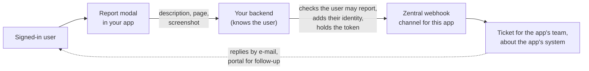

# Report an issue from your own app

Yes — the [webhook channel](connectors/webhook.md) is the way to connect your
own web applications: a **"Report a problem"** button, a feedback modal, or an
error boundary that offers to send what went wrong. It can carry the user's
description, who they are, where they were (page, version, browser) and up to
three screenshots or files.

## The one rule: the token stays on your server

The channel's token lets anyone holding it create tickets **as anyone they
like**. If it is shipped to the browser, every visitor can read it from the
page and send whatever they want, in whoever's name. So the browser talks to
*your* backend, and your backend — which knows who is signed in — talks to
Zentral:



Doing it this way also answers *"only certain users"*: your backend decides who
may report (a role, a feature flag, paying customers only) before forwarding
anything. And the requester's identity comes from your session, not from a
form field someone could edit.

## Set up

1. *Administration → Channels → Add channel → Webhook*, named after the app.
   Set **Default team** and **Default system** so reports from this app go
   straight to the right people. Copy the token once into your backend's secret
   store.
2. Optionally add an [automation rule](administration.md#automation-rules)
   *When channel is this one* to tag or prioritise reports.
3. Add the endpoint and the modal below.

## Your backend

```python
# FastAPI example — any framework works the same way.
import base64, os, httpx
from fastapi import Depends, Form, HTTPException, Request, UploadFile

ZENTRAL = os.environ["ZENTRAL_HOOK_URL"]      # https://desk.example.com/api/v1/hooks/<channel id>
TOKEN = os.environ["ZENTRAL_HOOK_TOKEN"]      # from your secret store, never sent to browsers
APP_VERSION = "3.14.2"

@app.post("/api/report")
async def report(
    request: Request,
    description: str = Form(max_length=20_000),
    page: str = Form(max_length=300),
    screenshot: UploadFile | None = None,
    user=Depends(current_user),               # your own authentication
):
    if not user.can_report:                    # your own rule
        raise HTTPException(403)
    files = []
    if screenshot:
        data = await screenshot.read(10 * 1024 * 1024 + 1)
        if len(data) > 10 * 1024 * 1024:
            raise HTTPException(413)
        files.append({"filename": screenshot.filename or "screenshot.png",
                      "content_base64": base64.b64encode(data).decode()})
    async with httpx.AsyncClient(timeout=30) as http:
        r = await http.post(ZENTRAL, headers={"Authorization": f"Bearer {TOKEN}"}, json={
            "title": description.splitlines()[0][:200] or "Problem report",
            "description": description,
            "requester_email": user.email,     # from your session, not from the form
            "requester_name": user.name,
            "system": "billing-app",
            "context": {"page": page, "app_version": APP_VERSION, "user_agent": request.headers.get("user-agent", "")[:300]},
            "attachments": files,
        })
    r.raise_for_status()
    return r.json()                            # {"tickets": "ZEN-512"}
```

## The modal in your app

Keep it small: what happened, an optional screenshot, send.

```html
<form id="report" hidden>
  <label>What went wrong? <textarea name="description" required></textarea></label>
  <label>Screenshot (optional) <input type="file" name="screenshot" accept="image/*"></label>
  <button>Send to the service desk</button>
</form>
<script type="module">
  const form = document.getElementById("report");
  // Let people paste a screenshot straight into the box.
  form.description.addEventListener("paste", (e) => {
    const file = [...e.clipboardData.files].find((f) => f.type.startsWith("image/"));
    if (file) { const dt = new DataTransfer(); dt.items.add(file); form.screenshot.files = dt.files; }
  });
  form.addEventListener("submit", async (e) => {
    e.preventDefault();
    const body = new FormData(form);
    body.append("page", location.pathname);   // a path, not the full URL: query strings can hold personal data
    const r = await fetch("/api/report", { method: "POST", body, credentials: "same-origin" });
    const { tickets } = await r.json();
    alert(`Thanks — your report is ${tickets}. We will reply by e-mail.`);
  });
</script>
```

## Good to know

- **Feedback as well as faults**: send `"severity": "info"` for suggestions,
  and route them with a rule — or use a second channel ("App feedback") with
  its own team.
- **Follow-up**: the reply goes to the user's e-mail; with the
  [requester portal](requester-portal.md) on, they can also follow the request
  there and send more screenshots.
- **Repeated reports of the same problem**: pass the same `thread_key` (for
  example the error's fingerprint) and they collect on one ticket.
- **Retries are safe**: give each report an `external_id` (or an
  `Idempotency-Key` header) and a retried request is accepted once.
- **What not to send**: passwords, session tokens, full URLs with query
  strings, or form contents the user did not mean to share. `context` is shown
  to the desk as plain text.
