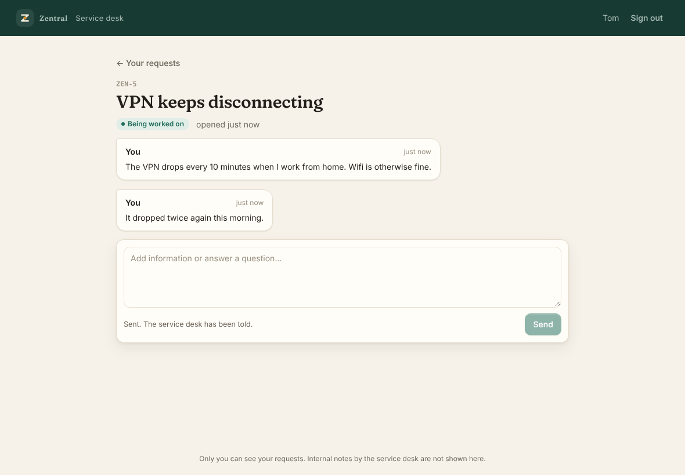
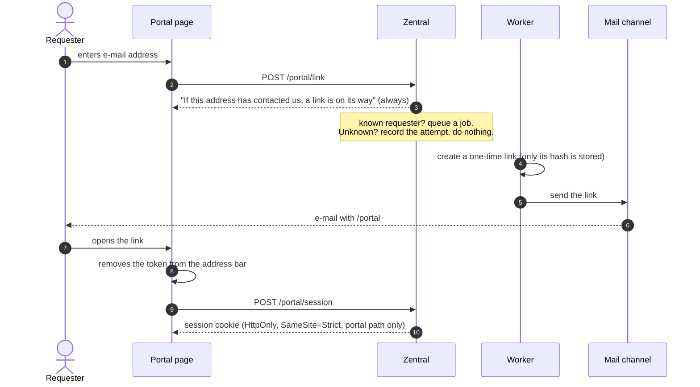

# Requester portal

The portal lets the people who contact your desk follow their requests,
answer questions, open new requests and rate the help they got — without an
account. It lives at `https://<your Zentral>/portal`.



## Turning it on

```bash
ZENTRAL_PORTAL_ENABLED=true
ZENTRAL_PORTAL_MAIL_CHANNEL="Service desk mailbox"   # the name of a mail channel
```

The mail channel sends the sign-in links, and the desk's replies to requests
opened in the portal. It must be allowed to send (*Send replies* on), and its
*Allowed recipient domains* apply to sign-in links too — so for an internal
desk, people outside your domains cannot even receive a link.

| Setting | Default | Meaning |
|---|---|---|
| `ZENTRAL_PORTAL_LINK_MINUTES` | 15 | How long a sign-in link works (once) |
| `ZENTRAL_PORTAL_SESSION_HOURS` | 8 | How long a portal session lasts |
| `ZENTRAL_PORTAL_LINKS_PER_HOUR` | 3 | Links per address per hour; more requests are ignored |

## How signing in works



Proof of identity is access to the mailbox the person used to contact you —
the same proof e-mail threading already relies on.

## What a requester can see and do

| Can | Cannot |
|---|---|
| See their own requests and where they stand | See anyone else's requests — another person's ticket is "not found" |
| Read their messages and the desk's replies | See internal notes, AI output, routing, priorities or staff names (replies show as "Service desk") |
| Reply; a reply to a resolved request reopens it | Reopen a closed request (they start a new one) |
| Send screenshots and files (paste or pick); see those, and files the desk sent them | See files the desk keeps internal (attached as notes) |
| Open a new request, optionally naming the system | Set priority, team or anything else the desk decides |
| Rate a resolved request once, within 30 days, 1–5 with an optional comment | Change a rating |

Their replies notify the assignee, like an e-mailed reply. Ratings appear on
the ticket (the comment is masked for roles without personal-data access) and
as *Requester satisfaction* in [Insights](agents.md#insights).

## Security notes

- **No account enumeration**: the sign-in request answers the same for every
  address, and the link is created and sent in the background, so neither the
  answer nor its timing reveals who is a requester.
- **Links** are single-use, short-lived and rate-limited; **sessions** are
  server-side, so signing out — or [erasing the person](privacy-officer.md) —
  ends them at once. Only SHA-256 hashes of either are stored.
- **The session cannot be read by the page** (HttpOnly) and is only sent to
  the portal's own API (`/api/v1/portal`). Every portal request must also carry
  a custom header, which a browser cannot send cross-site — with
  SameSite=Strict, this rules out cross-site request forgery.
- **Staff tokens do not open the portal, and portal sessions open nothing
  else.** A requester has no staff permission at all; each portal operation
  checks that the ticket belongs to the signed-in person.
- Every portal action is audited with the requester as actor
  (`contact:<id>`), on channel `portal`.

## Trying it locally

With the development sign-in, print a link for a seeded requester instead of
e-mailing it:

```bash
ZENTRAL_PORTAL_ENABLED=true ZENTRAL_PORTAL_MAIL_CHANNEL="Monitoring & forms" uv run zentral serve
uv run python scripts/portal_link.py tom.nielsen@example.com
```

The helper refuses to run outside development mode.
