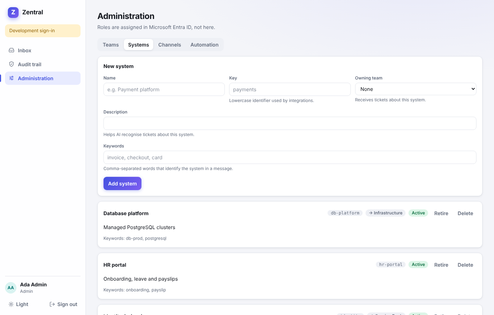
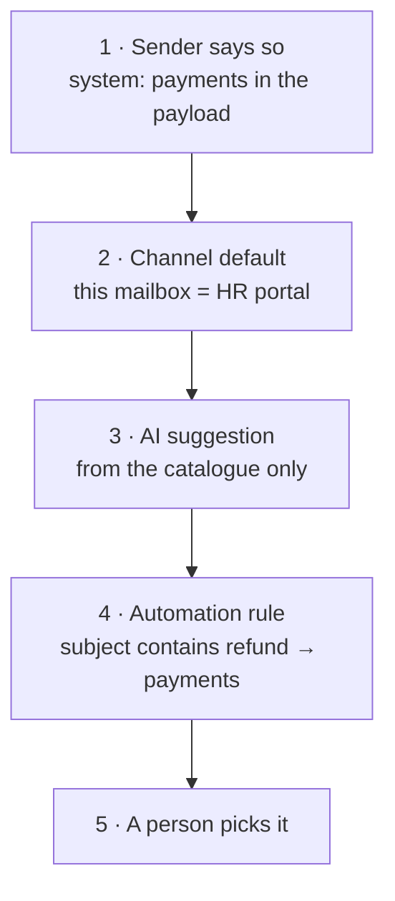

# Systems catalogue

Every ticket is about *something*: the payment platform, the HR portal, the web
shop, the VPN. Zentral makes that explicit. A **system** is an entry in a
catalogue that administrators maintain, and each ticket links to at most one.

Knowing the system lets you route to the team that owns it, filter the inbox,
see which systems generate the most work, and give AI a precise vocabulary to
choose from.

## Defining systems

*Administration → Systems*.

| Field | Meaning |
|---|---|
| **Name** | What people see: "Payment platform" |
| **Key** | A stable lowercase identifier for integrations: `payments` |
| **Owning team** | Tickets about this system go to this team if no team was set |
| **Description** | One line; helps AI recognise the system |
| **Keywords** | Words that identify the system in a message: `invoice, checkout, card` |

**Retire** a system when it is decommissioned: existing tickets keep the link,
but it can no longer be selected or suggested. *Delete* removes the link from
old tickets too — prefer retiring.

## How a ticket gets its system

This is the configurable part. Five mechanisms, in order of precedence — the
first one that provides a system wins, and nothing ever overwrites a choice
made earlier in the list or by a person.

| # | Mechanism | Configure it | Best for |
|---|---|---|---|
| 1 | **The sender names the system** | Services include `"system": "<key>"` in the [webhook](connectors/webhook.md) payload | Monitoring and applications that know what they are |
| 2 | **Channel default** | *Channels → Add channel → Default system* | A dedicated mailbox or Teams channel per system |
| 3 | **AI suggestion** | Automatic once systems exist; improve with descriptions and keywords | Shared inboxes where people describe problems in their own words |
| 4 | **Automation rule** | *Automation → Set system* | Hard rules you do not want to leave to a model |
| 5 | **Manual** | The *System* field on the ticket, or the *Set system to…* button | Everything else |

Rules run after the AI step and *do* override it — a rule is an explicit
administrator decision.

### What AI does and does not do

The model is given the active systems (key, name, description) and must answer
with one of those keys or nothing. Anything else is discarded. It is told not
to guess; the keyword fallback returns no suggestion when two systems match
equally. A suggestion below the confidence threshold is shown with a "?" and
not applied.

## Making it mandatory

Set `ZENTRAL_REQUIRE_SYSTEM_TO_RESOLVE=true` and a ticket cannot be resolved or
closed until it names a system. Use this once your catalogue is complete; the
**No system yet** card in the inbox shows the backlog.

## Using systems

- **Inbox**: the *System* column, the system filter, and the *No system yet*
  card.
- **Routing**: owning team, or rules with *When system is…*.
- **AI agents**: `list_systems`, and `system_id` on `search_tickets`,
  `create_ticket` and `update_ticket` ([MCP](mcp.md)).
- **API**: `GET /api/v1/systems`, `?system_id=` and `?no_system=true` on the
  ticket list.

## Starting out

1. List the 5–15 systems that cause most of your tickets. Do not model
   everything on day one.
2. Give each an owning team and three or four keywords.
3. Add `"system"` to the alerts your monitoring already sends.
4. Watch the *No system yet* count for two weeks and add what is missing.
5. Then consider making the system mandatory.
