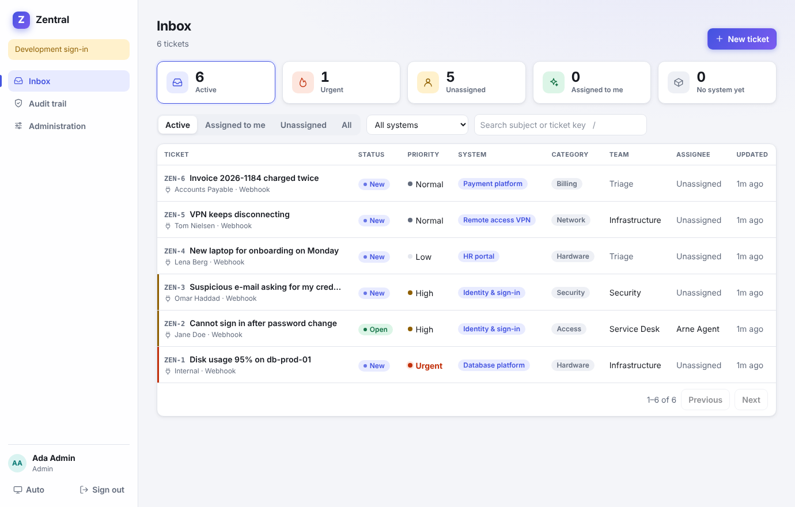

# Zentral

**A service desk built for private data.** Zentral collects issues from e-mail,
Microsoft Teams and your own systems into one inbox, triages them with AI that
can run entirely on your own hardware, and lets people *and* AI agents work
them — under the same identity, the same permissions and the same audit trail.

## What it does

| | |
|---|---|
| **One inbox, many channels** | E-mail (Microsoft 365), Microsoft Teams, and a signed webhook that any monitoring system or application can call. New channels are [plug-ins](extending/connectors.md). |
| **Every ticket names its system** | Tickets are linked to the business system they concern — payments, HR portal, web shop. The link can come from the sender, the channel, AI, a rule or a person. [How it works](guides/systems.md). |
| **AI triage on your terms** | Category, priority, system and a one-line summary for every new ticket. Use an [on-prem model](runbooks/switch-to-on-prem-ai.md); personal data is masked before any model sees it; the model can suggest but never act. |
| **AI agents are first-class** | A built-in [MCP server](guides/mcp.md) lets agents search, read, triage and annotate tickets with a least-privilege role. |
| **Your identity provider** | Microsoft Entra ID out of the box, or [any OpenID Connect provider](operations/identity-oidc.md). Zentral stores no passwords and no role assignments. |
| **Provable compliance** | Role-based access with team scoping, field-level encryption, a tamper-evident [audit trail](compliance/logging.md) of every access and change, and built-in [GDPR](compliance/gdpr.md) export, erasure and retention. |

## Where to start

- **Try it** — [Getting started](getting-started.md): a running instance in five minutes.
- **Deploy it** — [Deployment overview](operations/deployment.md) and the [first-deployment runbook](runbooks/first-deployment.md).
- **Understand it** — [Design principles](design-principles.md) and [architecture](architecture/overview.md).
- **Assess it** — [Security architecture](architecture/security.md), [threat model](architecture/threat-model.md) and the honest [security posture](compliance/security-posture.md).

## Who reads what

| You are… | Read |
|---|---|
| A service-desk agent | [Working tickets](guides/agents.md) |
| An administrator | [Administration](guides/administration.md), [Systems catalogue](guides/systems.md), channel guides |
| A privacy officer / DPO | [Privacy requests](guides/privacy-officer.md), [GDPR](compliance/gdpr.md) |
| An auditor | [Auditing](guides/auditor.md), [Logging and audit](compliance/logging.md), [Roles and permissions](compliance/rbac.md) |
| Building an AI agent | [AI agents over MCP](guides/mcp.md) |
| Operating the platform | [Operations](operations/deployment.md) and [runbooks](runbooks/index.md) |
| Extending Zentral | [Write a connector](extending/connectors.md), [Add an AI provider](extending/ai-providers.md) |
