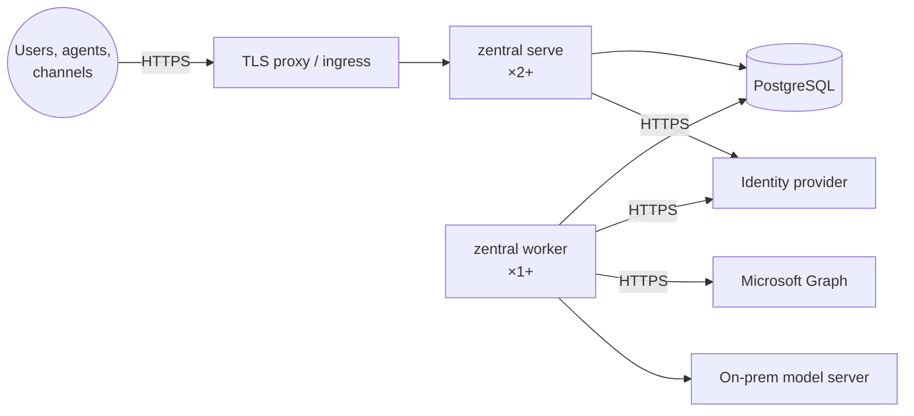

# Deployment overview

## What you run



One container image, two commands, one database. No broker, cache or search
cluster.

| Piece | Notes |
|---|---|
| `zentral serve` | REST API, MCP, webhooks, web client. Stateless; run ≥ 2 for availability. |
| `zentral worker` | Background jobs. One is enough; more are safe. |
| `zentral db upgrade` | Migrations; run once per release, before the new version serves traffic. |
| PostgreSQL 14+ | The only state. Use a managed service or your standard HA setup. |
| TLS proxy | Caddy, nginx, an ingress controller, or your load balancer. |
| Identity provider | [Entra ID](identity-entra.md) or [any OIDC provider](identity-oidc.md). |
| Model server (optional) | Ollama, vLLM, … for [on-prem AI](../runbooks/switch-to-on-prem-ai.md). |

## Choose a path

| | Trial | Docker Compose | Kubernetes |
|---|---|---|---|
| For | Trying Zentral on one VPS with made-up data | One host; small and medium desks | You already run Kubernetes |
| Sign-in | Persona picker behind a shared password | Entra ID or OIDC | Entra ID or OIDC |
| Keys | Plain text in `.env` | KMS-wrapped keyring | KMS-wrapped keyring |
| TLS | Automatic (Caddy; no DNS needed) | Automatic (Caddy) | Your ingress + cert-manager |
| Database | Included container | Included container (or external) | External (managed) |
| Guide | [Trial on a VPS](deploy-trial.md) | [Deploy with Docker Compose](deploy-compose.md) | [Deploy on Kubernetes](deploy-kubernetes.md) |

For a real installation, follow the **[first-deployment runbook](../runbooks/first-deployment.md)**
— it is the same ten steps with the platform-specific commands linked.

## Sizing

A service desk is a low-throughput system. Reasonable starting points:

| Component | CPU | Memory |
|---|---|---|
| API (each) | 0.1–0.5 core | 256–512 MiB |
| Worker | 0.1 core | 256–512 MiB |
| PostgreSQL | 1 core | 1–2 GiB; storage ≈ 5 kB per message + audit growth |
| Model server | Depends on the model; an 8 B model wants ~8 GiB (GPU or RAM) |

## Network requirements

**Inbound** (to the proxy): 443 from your users, your AI agents, and from
Microsoft Teams / other webhook senders if you use them.

**Outbound** from Zentral:

| To | Why | Who |
|---|---|---|
| Identity provider (e.g. `login.microsoftonline.com`) | Signing keys | API |
| `graph.microsoft.com`, `login.microsoftonline.com` | E-mail channel | Worker |
| Teams workflow hosts | Teams replies | Worker |
| Model server | Classification | Worker |

Nothing else. If you use the `rules` provider and only webhooks, the worker
needs no outbound access at all.

## The pre-flight check

After any configuration change:

```bash
zentral doctor
```

```text
✓ configuration: env=production, auth=entra
✓ database: postgresql, schema 0002
✓ encryption: 1 key(s) configured
✓ audit trail: 1284 events verified
✓ identity provider: entra: 6 signing key(s)
✓ AI provider: openai_compatible:llama3.1:8b (on-prem) → hardware
✓ connectors: email_graph, teams, webhook
✓ web client: /app/web

8 ok, 0 warning(s), 0 failure(s)
```

It exits non-zero on failure, so you can use it as a deployment gate. It never
prints secrets. Among other things it tells you when the configured encryption
key cannot read existing data — the classic restore mistake.

## Production checklist

- [ ] `ZENTRAL_ENV=production` (enables the start-up safety checks and HSTS)
- [ ] HTTPS public URL; `ZENTRAL_ALLOWED_HOSTS` set to your hostname
- [ ] PostgreSQL with TLS, backups and point-in-time recovery
- [ ] The three keys generated, in a secret manager, **backed up separately
      from the database**
- [ ] Roles assigned in the identity provider; at least two admins, one
      auditor, one privacy officer — different people
- [ ] Proxy forwards the client address, and `--forwarded-allow-ips` names
      only the proxy
- [ ] Logs shipped to your log platform; alerts set up ([Monitoring](monitoring.md))
- [ ] `zentral doctor` clean
- [ ] Runbooks read by the people on call
- [ ] Your own DPIA and security review done
      ([Security posture](../compliance/security-posture.md))
