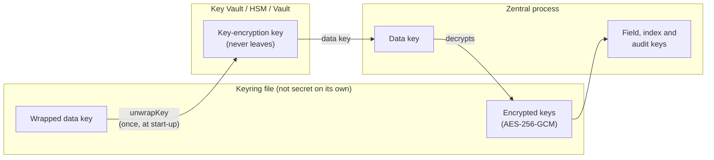

# Key custody (KMS / HSM)

Zentral's keys (field encryption, blind index and audit chain) can live in
two places:

| `ZENTRAL_KEY_PROVIDER` | Where the keys are | Use |
|---|---|---|
| `env` *(default)* | In plain text in environment variables | Development. Production only with `ZENTRAL_ALLOW_ENV_KEYS=true`, and `zentral doctor` warns |
| `azure_keyvault` | In a **keyring** whose data key is wrapped by a key in Azure Key Vault or Managed HSM | Production on Azure / Entra-centric estates |
| `vault_transit` | Same, wrapped by HashiCorp Vault (or OpenBao) Transit | Production elsewhere |
| `local_file` | Same, wrapped by a key in a local file | Development, tests, offline escrow copies. Refused in production |
| *a plug-in* | Same, wrapped by your KMS (AWS KMS, PKCS#11, …) | See [Plug-ins](#plug-ins) |

## How it works



- The **keyring** (`ZENTRAL_KEYRING_FILE`) is a small JSON document: the key
  material encrypted with AES-256-GCM under a random data key, plus that data
  key *wrapped* by the KMS. Its header (provider, key-encryption key version,
  date) is authenticated, so it cannot be edited unnoticed.
- At start-up the API, the worker and every `zentral` command make **one**
  call to the KMS to unwrap the data key. The keys then exist only in the
  process's memory — not in the environment, the configuration, the
  container spec or the orchestrator's secret store.
- The keyring is useless without permission to use the KMS key, so it can sit
  in a ConfigMap, a mounted file, or a backup next to the configuration.
- The application's identity needs only **unwrap**. **Wrap** — creating or
  changing a keyring — is an administrator permission.

!!! info "What this does and does not protect against"
    It removes the keys from everything that is *copied around*: environment
    variables, `.env` files, deployment manifests, CI variables, crash dumps of
    the orchestrator, backups of the configuration. It also gives you a kill
    switch (revoke the identity's unwrap permission) and an audit log of every
    unwrap in the KMS.

    It does **not** protect against an attacker who controls the running
    process: the keys are in its memory, as they must be to encrypt and
    decrypt. The audit HMAC is computed in-process for the same reason — an
    HSM round-trip for every audit event, under the chain lock, would
    serialise every write in Zentral on KMS latency. See the
    [threat model](../architecture/threat-model.md#infrastructure-compromise).

## Set up with Azure Key Vault or Managed HSM

1. **Create the key-encryption key.** Use a Premium vault (HSM-backed keys) or
   a Managed HSM (FIPS 140-3 Level 3). Turn on **soft-delete and purge
   protection**: if this key is deleted, every keyring wrapped by it, and so
   the data, is lost.

    ```bash
    az keyvault key create --vault-name desk-kv --name zentral-kek \
      --kty RSA-HSM --size 3072 --ops wrapKey unwrapKey
    ```

2. **Give the application's managed identity unwrap only.** Built-in roles
   grant wrap as well, so create a custom role:

    ```json
    {
      "Name": "Zentral key unwrap",
      "Actions": [],
      "DataActions": ["Microsoft.KeyVault/vaults/keys/unwrap/action"],
      "AssignableScopes": ["/subscriptions/<sub>/resourceGroups/<rg>/providers/Microsoft.KeyVault/vaults/desk-kv"]
    }
    ```

    Assign it on the key (not the vault) to the identity the API and worker run
    as. Administrators who run `zentral keys` commands need
    `…/keys/wrap/action` as well (*Key Vault Crypto User*, assigned
    just-in-time with PIM).

3. **Configure Zentral** (all non-secret):

    ```bash
    ZENTRAL_KEY_PROVIDER=azure_keyvault
    ZENTRAL_AZURE_KEYVAULT_KEY_ID=https://desk-kv.vault.azure.net/keys/zentral-kek
    ZENTRAL_KEYRING_FILE=/etc/zentral/keyring.json
    # User-assigned identity? ZENTRAL_AZURE_MANAGED_IDENTITY_CLIENT_ID=<client id>
    ```

    Authentication is by managed identity only: App Service / Container Apps,
    AKS workload identity, or a VM's identity are detected automatically. There
    is deliberately no client-secret option — it would put a credential back
    into the environment.

4. **Create the keyring** — [new installation](#new-installation) or
   [existing installation](#move-an-existing-installation).

For a Managed HSM use `https://<hsm>.managedhsm.azure.net/keys/<name>`; with an
AES key there, set `ZENTRAL_AZURE_KEYVAULT_ALGORITHM=A256KW`.

## Set up with HashiCorp Vault Transit

1. **Create the Transit key:**

    ```bash
    vault secrets enable transit
    vault write -f transit/keys/zentral type=aes256-gcm96
    ```

2. **Policies.** The application:

    ```hcl
    path "transit/decrypt/zentral" { capabilities = ["update"] }
    ```

    Administrators additionally get `transit/encrypt/zentral`.

3. **Configure Zentral:**

    ```bash
    ZENTRAL_KEY_PROVIDER=vault_transit
    ZENTRAL_VAULT_ADDR=https://vault.corp.example:8200
    ZENTRAL_VAULT_TRANSIT_KEY=zentral
    ZENTRAL_KEYRING_FILE=/etc/zentral/keyring.json
    # Kubernetes auth:
    ZENTRAL_VAULT_KUBERNETES_ROLE=zentral
    # …or a token file kept fresh by Vault Agent:
    # ZENTRAL_VAULT_TOKEN_FILE=/vault/secrets/token
    ```

    On Kubernetes, the base manifests do not mount the service-account token
    (`automountServiceAccountToken: false`). For Kubernetes auth, add a
    projected token volume with your Vault's audience to the API and worker
    pods and point `ZENTRAL_VAULT_KUBERNETES_TOKEN_FILE` at it.

## New installation

In an administrator shell with the provider settings above (and wrap
permission):

```bash
zentral keys init --output keyring.json
# wrote keyring.json (azure_keyvault, KEK https://desk-kv.vault.azure.net/keys/zentral-kek/3f2a…)
```

The keys are generated, sealed and checked to open again; they are never
displayed. Deliver `keyring.json` to the deployment:

=== "Docker Compose"

    Place it next to `compose.yaml` and mount it read-only into `api`, `worker`
    and `migrate` at `/etc/zentral/keyring.json`.

=== "Kubernetes"

    ```bash
    kubectl -n zentral create configmap zentral-keyring --from-file=keyring.json
    ```

    Mount it at `/etc/zentral/keyring.json` in the API, worker and migrate Job.

Then `zentral doctor`:

```
✓ key custody: azure_keyvault: data key wrapped by https://desk-kv.vault.azure.net/keys/zentral-kek/3f2a…, keyring sealed 2026-11-17T10:12:00+00:00
```

## Move an existing installation

Your keys are currently in `ZENTRAL_ENCRYPTION_KEYS`, `ZENTRAL_BLIND_INDEX_KEY`,
`ZENTRAL_AUDIT_HMAC_KEY` (and perhaps `…_PREVIOUS_KEYS`). Nothing in the
database changes.

1. In an administrator shell that has **both** the current keys and the
   provider settings:

    ```bash
    zentral keys wrap --output keyring.json
    ```

2. Deliver `keyring.json` (above), set `ZENTRAL_KEY_PROVIDER`,
   `ZENTRAL_KEYRING_FILE` and the provider settings in the deployment, and
   **remove the four key variables** from it. Zentral refuses to start if keys
   are set in the environment *and* a provider is configured.
3. Restart API and worker; `zentral doctor` must show `✓ key custody` and
   `✓ encryption`.
4. Delete the plain-text keys from the old secret store, its history and any
   `.env` files — after the [escrow copy](#escrow-and-disaster-recovery) is
   made.

## Everyday operations

| Task | Command | Restart? | Database touched? |
|---|---|---|---|
| Describe the keyring (fingerprints only) | `zentral keys show` | — | — |
| Rotate the key-encryption key | Rotate it in the KMS, then `zentral keys rewrap` | Yes | No |
| Rotate the field-encryption key | `keys add-data-key` → restart → `keys rotate` → `keys retire-data-keys` | Yes, after each change | Re-encrypted by `keys rotate` |
| Rotate the audit key | `zentral keys rotate-audit-key` → restart | Yes | No |
| Revoke access in an emergency | Remove the unwrap permission in the KMS | Processes keep running; new ones cannot start | No |

Every command that changes the keyring writes it atomically (mode 600), checks
that it opens again, and keeps the previous version as
`keyring.json.<timestamp>.bak`. Those backups are still wrapped by the KMS and
are what you need to read **database backups taken under retired keys** — keep
them as long as those backups. Full procedures:
[key rotation runbook](../runbooks/key-rotation.md).

## Escrow and disaster recovery

The KMS key is now the single thing that, if lost, makes all data
unrecoverable. Protect it twice:

1. **In the KMS.** Soft-delete and purge protection (Key Vault), HSM security
   domain backup (Managed HSM), or Vault's own backup and seal recovery.
2. **Outside it — an offline escrow keyring.** A second keyring holding the
   same keys, wrapped by a key on removable media kept in a safe:

    ```bash
    zentral keys new-local-kek /media/escrow/zentral-escrow.kek
    ZENTRAL_LOCAL_KEK_FILE=/media/escrow/zentral-escrow.kek \
      zentral keys rewrap --to-provider local_file --output /media/escrow/keyring-escrow.json
    ```

    Store the medium with your other break-glass material (two-person access).
    Redo this after every change of the keys (`add-data-key`,
    `retire-data-keys`, `rotate-audit-key`) — not after `rewrap`, which does not
    change them.

**Recovering without the KMS** (it is gone, or you are restoring somewhere
else): start Zentral with `ZENTRAL_KEY_PROVIDER=local_file`,
`ZENTRAL_LOCAL_KEK_FILE` and `ZENTRAL_KEYRING_FILE` pointing at the escrow pair
in a **non-production** environment, verify with `zentral doctor` and
`zentral audit verify`, then `zentral keys rewrap --to-provider azure_keyvault`
(or `vault_transit`) into a new KMS and switch production to it.

## Plug-ins

A key provider is a subclass of `zentral.security.keys.KeyProvider` with a
`name`, `wrap(dek) -> WrappedKey` and `unwrap(WrappedKey) -> bytes`,
registered under the `zentral.key_providers` entry-point group:

```toml
[project.entry-points."zentral.key_providers"]
aws_kms = "zentral_aws_kms:AwsKmsProvider"
```

It receives the settings and a synchronous `httpx.Client` (timeouts, no
redirects). Never include key material in exception messages; raise
`KeyCustodyError`. `production_ready = False` keeps a provider out of
production.

## Troubleshooting

| Message | Cause |
|---|---|
| `keys are also set in the environment: remove …` | A provider is configured but the old variables are still set |
| `needs ZENTRAL_KEYRING_FILE` | Create one with `zentral keys init` or `zentral keys wrap` |
| `Key Vault refused unwrapKey (HTTP 403)` | The identity lacks the unwrap permission, or the key is disabled |
| `no managed identity token` | No managed identity on this host, or the wrong client ID |
| `the keyring was wrapped by …, which is not the configured key` | The keyring belongs to another vault or key: check `ZENTRAL_AZURE_KEYVAULT_KEY_ID` |
| `the keyring failed its integrity check` | The file was edited or truncated: restore it from a `.bak` or the escrow copy |
| `production refuses plain-text keys in the environment` | Move to a keyring (above), or knowingly set `ZENTRAL_ALLOW_ENV_KEYS=true` |
