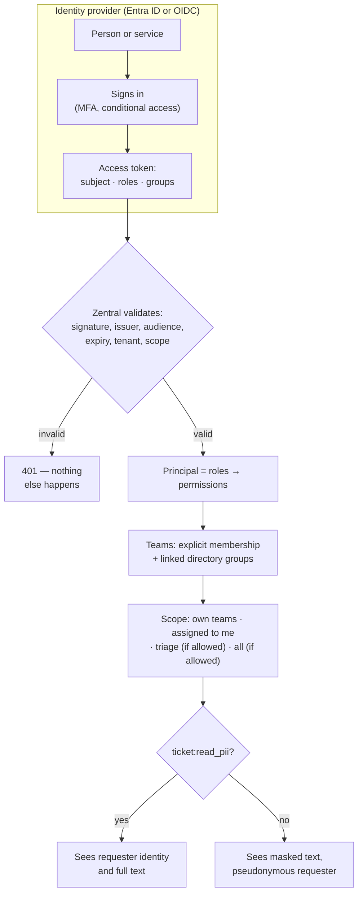
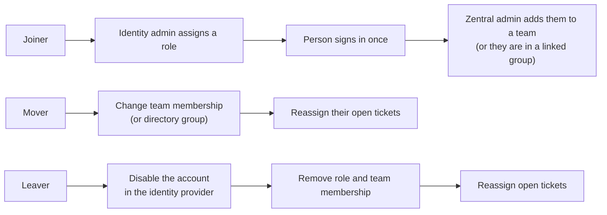
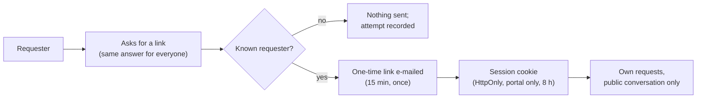

# People and access

## How people come in

Zentral keeps no passwords and assigns no roles. People and services arrive
through your identity provider; Zentral only reads what the access token says.

| Question | Answer |
|---|---|
| Who decides *what* someone may do? | The **identity administrator**, by assigning one of seven roles |
| Who decides *which tickets* they see? | The **Zentral admin**, by team membership (or a linked directory group) |
| What does Zentral store about staff? | Object ID, display name and e-mail, refreshed at sign-in — so they can be shown as assignee or author |
| How long does a removed role keep working? | Until the person's access token expires (typically under an hour) |

## Joiners, movers, leavers

The detailed checklist is in the [access review runbook](../runbooks/access-review.md#leaver-checklist-do-not-wait-for-the-quarterly-review).

## Requesters

People who ask for help never get a staff account. In the
[requester portal](../guides/requester-portal.md) they prove who they are by
opening a one-time link sent to the address they used, and then see only their
own requests and the public conversation.

## Machines are people too (almost)

| Caller | Credential | What it may do |
|---|---|---|
| AI agent (MCP) | Token for its own identity, usually `Zentral.Automation` | Triage and annotate masked tickets; never reply to requesters |
| Script / integration | Token for its own identity, a narrow role | Whatever that role allows |
| Monitoring system | Per-channel ingest token | Create messages on that one channel |
| Teams / Slack | Per-channel signing secret | Create messages on that one channel |
| Zentral's worker | Internal only, never reachable over the network | Recorded as `system:worker` |
| Requester (portal) | One-time e-mail link, then a portal-only session | Their own requests; recorded as `contact:<id>` |

## Outcome

Everyone sees exactly what their role and teams allow, and every action is
attributed to a stable identity in the audit trail.
