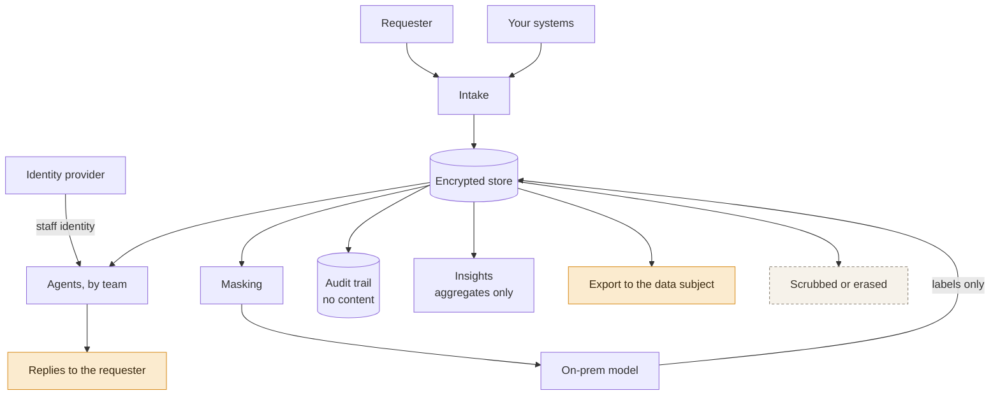
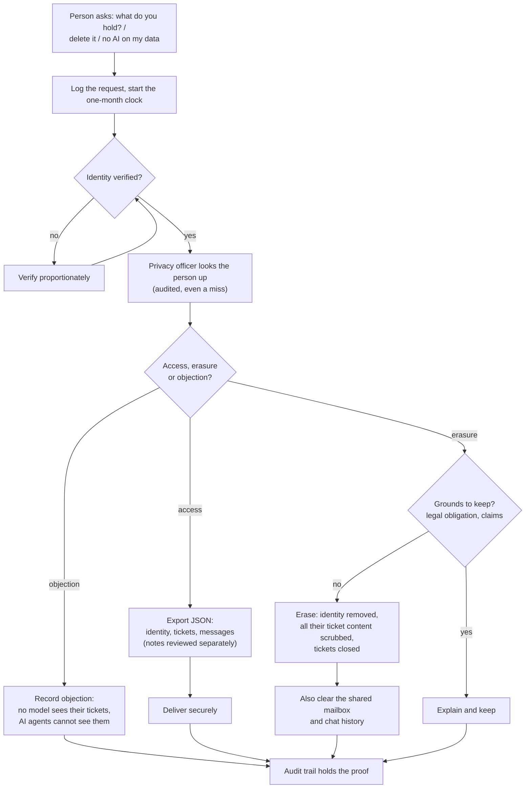
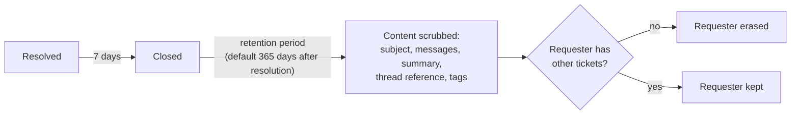

# Personal data: where it comes from, who owns it, where it ends

The controller of all personal data in Zentral is **your organisation**. The
table below says, for each kind of data, why it is there, who is accountable
for it day to day, who can see it, how it is protected, and when it ends.

## The data map

### Where it comes from, and why

| Data | Source | Purpose | Accountable |
|---|---|---|---|
| **Requester identity** — name, e-mail or chat ID | The incoming message | To reply, and to link one person's requests | Privacy officer |
| **Request content** — subject, messages | Requester and staff | To solve the problem | The handling team |
| **Internal notes** | Staff, AI agents | Working notes | The handling team |
| **AI summary and labels** | The classifier | Faster triage | The handling team |
| **Ticket metadata** — status, priority, system, team, times | Zentral | Running the desk; statistics | Admin |
| **Staff identity** — ID, name, e-mail | Identity provider, at sign-in | Showing who did what | Admin |
| **Audit events** | Zentral | Accountability and security | Auditor |
| **Notifications** | Zentral | Telling staff what needs them | Admin |
| **Operational logs** | Zentral | Running the system | Platform owner |
| **Channel secrets** | Admin | Connecting channels | Admin |

### Who can see it, how it is protected, when it ends

| Data | Who can see it | Protection | End of life |
|---|---|---|---|
| **Requester identity** | Roles with `ticket:read_pii`, within team scope | Encrypted; found only through a keyed hash | On erasure, or once they have no tickets left after retention |
| **Request content** | Team scope; masked without `ticket:read_pii` | Encrypted | Scrubbed `ZENTRAL_RETENTION_DAYS` after resolution, or on erasure |
| **Internal notes** | Team scope | Encrypted | With the ticket content |
| **AI summary and labels** | Team scope | Summary encrypted | With the ticket content |
| **Ticket metadata** | Team scope; aggregates in Insights | Contains no content | Kept as anonymous statistics |
| **Staff identity** | Whoever can see the tickets they touched | Database access control | While they use Zentral; remove leavers |
| **Audit events** | Auditors, admins, privacy officers | Hash-chained, append-only, no content | Your audit retention policy |
| **Notifications** | Only the person they are for | No content: a ticket key and an event | 30 days after reading, 90 days at most |
| **Operational logs** | Operators | Your log platform; masked as a safety net | Your log retention policy |
| **Channel secrets** | Nobody — write-only | Encrypted | When the channel is deleted |

## Data flow

Amber marks the only ways data leaves: a reply to the person who asked, and an
export to the person it is about.

What never leaves: ticket content does not go to logs, to the audit trail, to
Insights, or — with an on-prem model — outside your network.

## Requests

Step by step: [Data-subject request runbook](../runbooks/data-subject-request.md).

## Retention

Runs every six hours in the worker. Every scrub and erasure is an audit event
(`retention.ticket_scrubbed`, `retention.contact_erased`), so you can show it
happened.

## Outcome

Data exists only as long as there is a reason for it, every access to it is
attributable, and its end is recorded.
