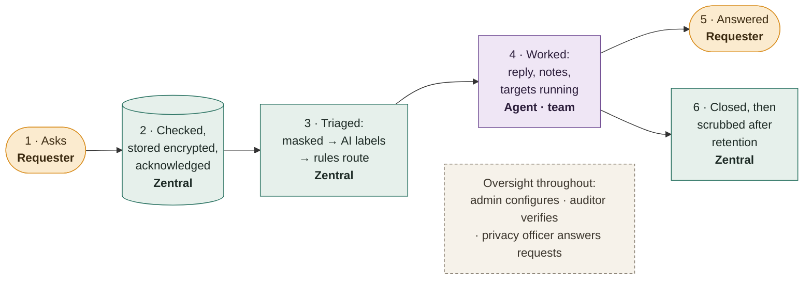

# How Zentral works

These pages are process maps. Each answers the same four questions:

1. **What comes in, and why** — who or what starts the process, and the reason Zentral needs it.
2. **What happens** — every step, including the ones nobody sees.
3. **Who owns it** — the role accountable for each step and for the data it produces.
4. **What the outcome is** — what exists afterwards, for how long, and who can see it.

## The whole journey on one page

Every request follows the same path, whichever door it came through. Colour
shows who owns each stage — **amber** the requester, **green** Zentral's
automatic steps, **violet** the service desk — and the cylinder marks the
moment personal data is written. Oversight runs alongside everything.

## The processes

| Process | Starts when | Owner | Outcome | Map |
|---|---|---|---|---|
| **Intake** | A message arrives on a channel | Zentral; the channel is owned by an admin | A ticket (or a new message on an existing one), acknowledged, queued for triage | [Intake](intake.md) |
| **Triage** | A ticket is created | Zentral (AI + rules); agents correct | Category, priority, system and team set; targets planned | [Triage](triage.md) |
| **Working a ticket** | An agent opens it | The assignee, within their team | Replies to the requester, notes, a resolution | [Ticket lifecycle](lifecycle.md) |
| **Service-level targets** | A ticket is created or its priority changes | The team; visible to everyone working it | A first reply and a resolution in time — or a visible overdue | [Ticket lifecycle](lifecycle.md#targets) |
| **Closing the loop** | A ticket is resolved | Zentral | Closed after the grace period; content scrubbed after retention | [Ticket lifecycle](lifecycle.md#closing) |
| **People and access** | Someone signs in, joins, moves or leaves | Identity administrator; Zentral admin for teams | The right people see the right tickets, nobody else | [People and access](access.md) |
| **Data-subject requests** | A person asks for their data, or its deletion | Privacy officer | An export, or an erasure that is provable | [Personal data](data.md#requests) |
| **Retention** | Time passes | Zentral, configured by the controller | Data that is no longer needed is gone | [Personal data](data.md#retention) |
| **Oversight** | Continuously | Auditor | Evidence that every access and change was legitimate | [Oversight](oversight.md) |
| **Learning** | Whenever someone looks | Team leads, admins | Where work comes from, and whether promises are kept | [Oversight](oversight.md#insights) |

## Who does what (RACI)

**R**esponsible does the work · **A**ccountable owns the outcome · **C**onsulted ·
**I**nformed. "Zentral" means the automatic steps; they are accountable to the
role that configures them.

| | Requester | Agent | Admin | Privacy officer | Auditor | Identity admin | Zentral |
|---|:-:|:-:|:-:|:-:|:-:|:-:|:-:|
| Raise a request | R/A | | | | | | |
| Authenticate the channel | | | A | | | | R |
| Store and protect the ticket | | | A | C | | | R |
| Acknowledge receipt | I | | A | | | | R |
| Triage (labels, routing) | | C | A | | | | R |
| Pick up and work a ticket | I | R/A | | | | | |
| Meet the targets | I | R | A | | | | C |
| Close the loop | I | R | A | | | | R |
| Configure channels, teams, systems, rules | | | R/A | C | I | | |
| Assign roles | | | C | | I | R/A | |
| Answer a data-subject request | I | C | | R/A | I | | C |
| Retention and scrubbing | | | C | A | I | | R |
| Verify the audit trail | | | I | I | R/A | | C |

Who holds which permission is generated from the code in
[Roles and permissions](../compliance/rbac.md).
