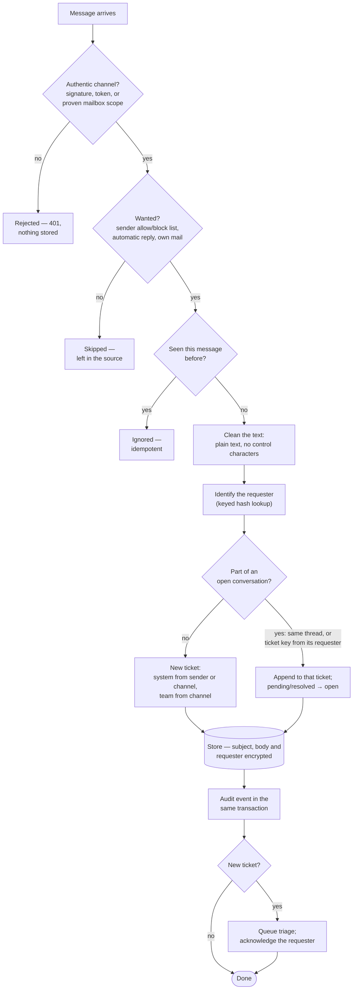
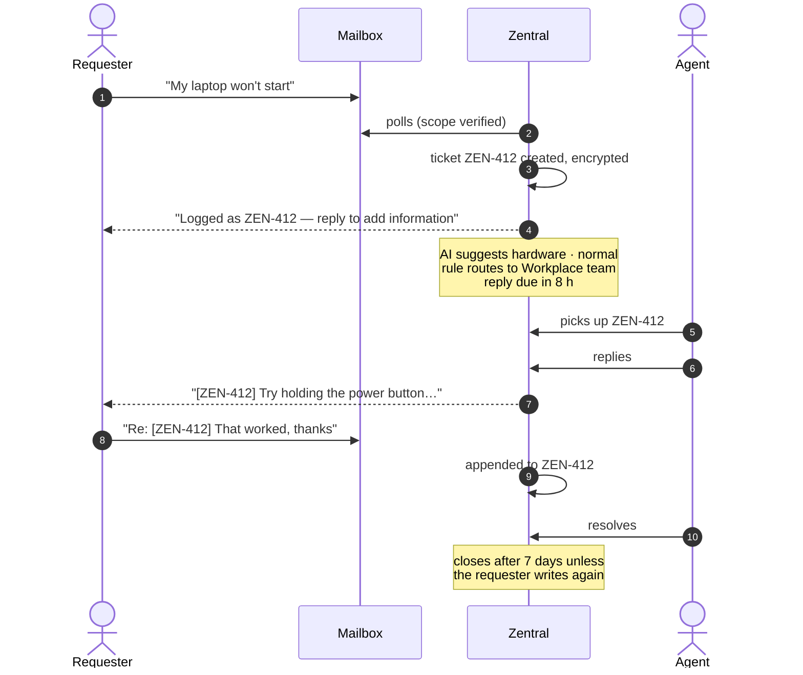

# Intake: how requests come in

## What comes in, and why

| Door | Who uses it | Why it exists | What arrives |
|---|---|---|---|
| **E-mail** (Microsoft 365 shared mailbox) | Anyone — staff, customers, partners | The one channel everybody already has | Sender address and name, subject, body as plain text |
| **Microsoft Teams** (@mention in a channel) | Staff | Asking where people already work | Directory ID and name, message text |
| **Webhook** | Your systems: monitoring, CI, applications | Machines notice problems before people do | Title, description, severity, optionally the system and a requester |
| **Requester portal** | People who contacted the desk before | Following up without writing another e-mail | Subject, description, optionally the system; replies on their own requests |
| **By hand** (web, API) | Agents, on behalf of a caller | Phone calls and walk-ups | Whatever the agent types |
| **MCP** | AI agents | Automation that opens internal tickets | Subject and body; no requester |
| **Plug-ins** (e.g. Slack) | Your choice | New channels without changing Zentral | Normalised by the plug-in |

Zentral collects only what it needs to answer the request: who asked (so the
answer reaches them) and what they wrote (so someone can help). HTML and
formatting are not ingested. Files and screenshots are accepted only when
[attachments](../guides/attachments.md) are enabled, and only after they are
checked by content, stripped of metadata and scanned for malware.

## What happens to every message

Every door ends in the same pipeline, so the same checks apply to all of them.

### The decisions, and who owns them

| Step | Decided by | Configured by | Why it matters |
|---|---|---|---|
| Authenticity | The connector, before anything is parsed | Admin (channel secrets) | An unauthenticated request never touches the database |
| Mailbox scope | The mail connector, hourly | Exchange admin | Zentral refuses to run with credentials that could read other mailboxes |
| Wanted / unwanted | The mail connector | Admin (channel settings) | Stops loops, newsletters and out-of-office storms |
| Duplicate | Core, by message ID | — | Retries by senders and platforms never create twins |
| Threading | Core | — | A reply lands on its ticket; a guessed ticket number from someone else does not |
| System | Sender → channel default | Admin (systems, channel) | See [Systems](../guides/systems.md#how-a-ticket-gets-its-system) |
| Acknowledgement | Core, for new tickets | Admin (per channel, text included) | The requester knows it arrived and has a reference |

## Seen from the requester

## Outcome

- **A ticket** with an encrypted subject and conversation, linked to a
  requester (by keyed hash) and, where known, a system and a team.
- **An acknowledgement** to the requester, if the channel sends them.
- **A triage job** queued in the same transaction — it cannot be lost.
- **An audit event** (`ticket.ingested` or `ticket.message_received`) with
  identifiers only.
- **Nothing else**: no copy in logs, no copy at the AI provider yet.

Owner of the data from this moment: the **controller** (your organisation),
exercised day to day by the **team** the ticket is routed to.

!!! warning "Acknowledgements and spoofed senders"
    An acknowledgement goes to the address the mail claims to come from. If
    your mailbox accepts mail from the internet, a spoofed sender would receive
    an acknowledgement they did not ask for. Enforce DMARC in Exchange (it
    rejects spoofed mail before Zentral sees it), use *Allowed sender domains*
    for internal desks, and consider turning acknowledgements off for a
    mailbox that is open to anyone.
