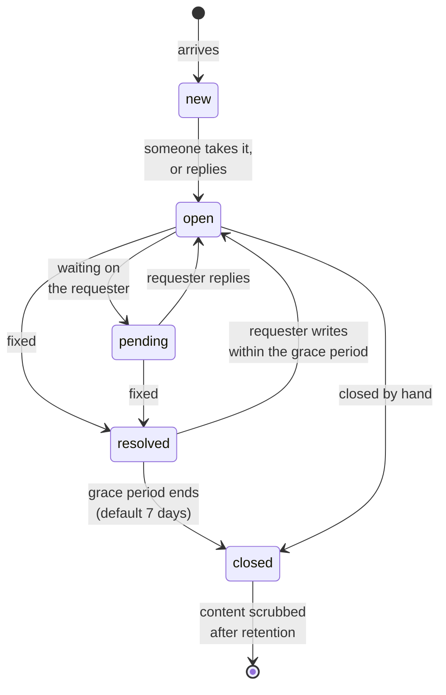
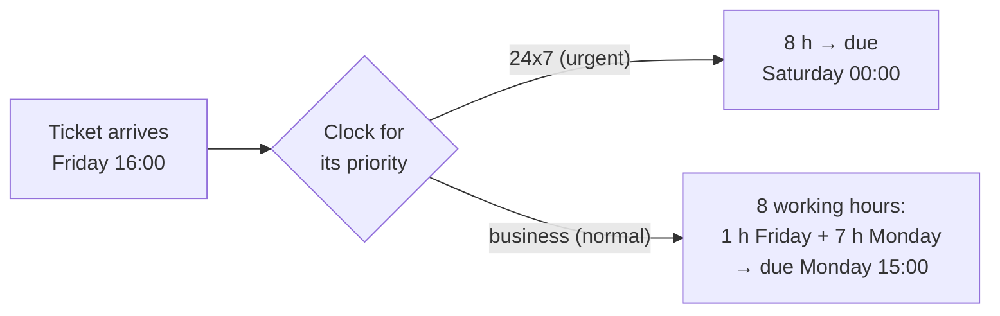
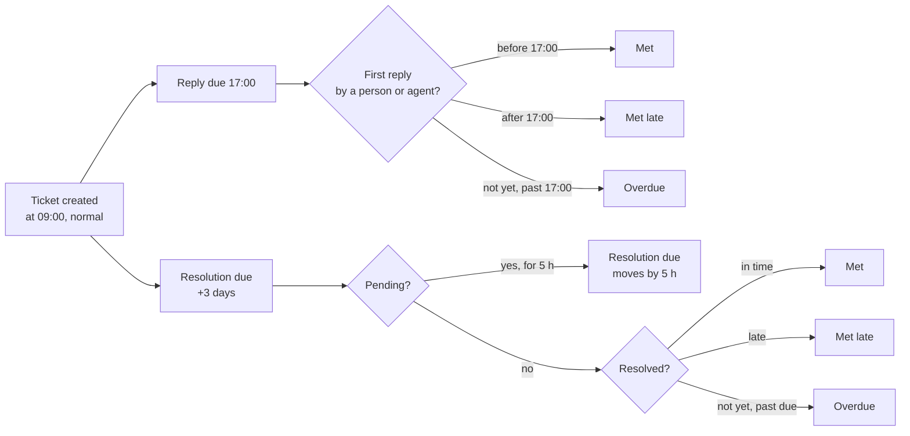
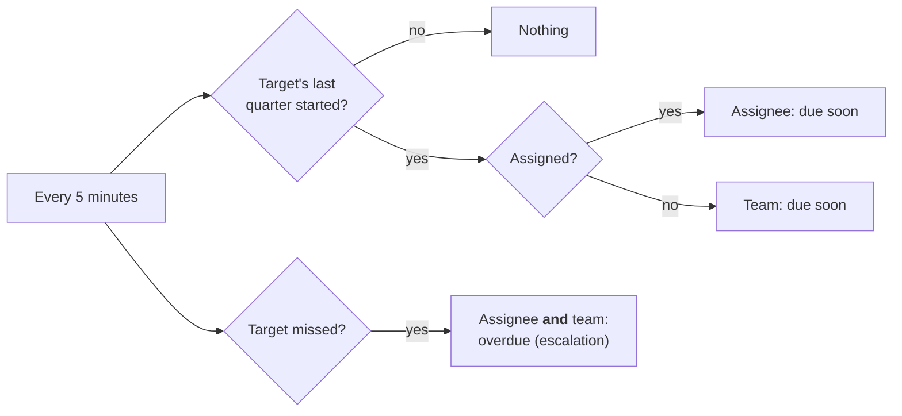
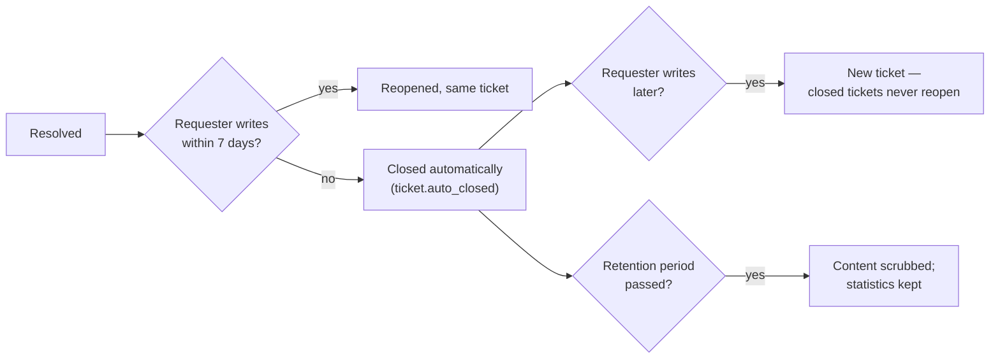
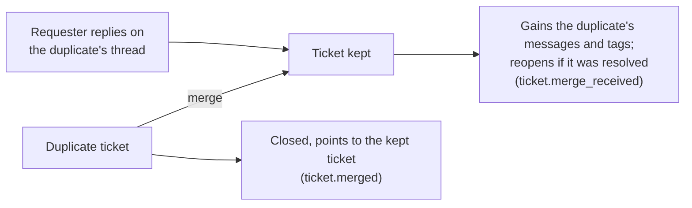

# Ticket lifecycle

## States

| State | Meaning | Who moves it here | The clocks |
|---|---|---|---|
| **New** | Nobody has touched it | Zentral, on arrival | Both running |
| **Open** | Being worked | An agent (assigning or replying), or the requester (replying) | Both running |
| **Pending** | The desk is waiting for the requester | An agent | Resolution clock **paused** |
| **Resolved** | Fixed, but the requester can still say "it isn't" | An agent | Stopped; result recorded |
| **Closed** | Finished; a new message starts a new ticket | Zentral after the grace period, or an agent | Stopped |

## Targets

Every ticket makes two promises, set by its priority — and by its system, when
the system has [targets of its own](../guides/systems.md#targets-per-system).

| Priority | First reply | Resolution |
|---|---|---|
| Urgent | 1 hour | 8 hours |
| High | 4 hours | 1 day |
| Normal | 8 hours | 3 days |
| Low | 1 day | 7 days |

These are the defaults; set your own with `ZENTRAL_SLA_RESPONSE_HOURS` and
`ZENTRAL_SLA_RESOLVE_HOURS`, e.g. `urgent=0.5,high=2,normal=8`. A priority left
out has no target.

### Which hours count

With working hours configured (`ZENTRAL_BUSINESS_HOURS`), each priority runs on
one of two clocks (`ZENTRAL_SLA_CALENDAR`):

Holidays (`ZENTRAL_HOLIDAYS`) are skipped like weekends, and time spent
*pending* is measured on the same clock: waiting over a weekend costs a
business-clock ticket nothing. The *Targets* panel says which clock a ticket
uses.

The rules behind it:

- **Only a real reply counts.** An agent's or AI agent's reply to the requester
  meets the first-reply target. An internal note does not; neither does the
  automatic acknowledgement.
- **Waiting on the requester pauses the resolution clock**, and the paused time
  is added to the deadline when the ticket becomes active again — whether an
  agent reopens it or the requester replies.
- **Changing the priority re-plans both targets from the creation time.** Raising
  a ticket to urgent can make it overdue immediately; that is deliberate.
- **Internal tickets** (no requester) have no first-reply target.

### When a target is in danger

Every five minutes the worker looks at open tickets (pending tickets are
waiting on the requester and are left alone):

Each warning is sent once per deadline, and recorded as `ticket.escalated`
on the ticket's activity. When a deadline moves (new priority, new system, back
from pending), warnings are armed again. `ZENTRAL_ESCALATION_WARN_FRACTION`
sets when "due soon" starts (default `0.25`; `0` sends only the overdue
escalation).

Where people see it:

| Where | What |
|---|---|
| Inbox, *Overdue* card | Count and filter of active tickets past a target |
| Inbox, *Due* column | The next promise: "Reply in 40m", "Resolve in 2d", "Waiting on requester", "Reply overdue · 2h ago" |
| Ticket, *Targets* panel | Both targets, their state and exact times |
| Insights | Share met on time, medians, trend |

## Closing

The grace period is `ZENTRAL_AUTO_CLOSE_DAYS` (default 7; 0 turns automatic
closing off). It runs with the six-hourly housekeeping job, together with
[retention](data.md#retention).

## Duplicates

When the same person raises the same problem twice, an agent (or an AI agent)
merges the duplicate into the ticket to keep:

Only tickets from the **same requester** (or a duplicate with no requester) can
be merged: merging two people's tickets would put one person's words on the
other's ticket and send replies to only one of them. Merging cannot be undone.

## Who owns a ticket

| Phase | Owner | Can see it |
|---|---|---|
| Untriaged | Triage (agents with `ticket:triage`) | Agents, admins, privacy officers, AI agents |
| In a team | The team | That team's members, its assignee, admins, privacy officers |
| Assigned | The assignee, on behalf of the team | As above; the assignee keeps access even if it is re-routed |
| Resolved, closed | The team | As above |
| Scrubbed | Nobody — only statistics remain | As above, without content |

## Outcome

A resolved and eventually closed ticket, a requester who got an answer, an
honest record of whether it happened in time, and — after the retention
period — no personal data left behind.
