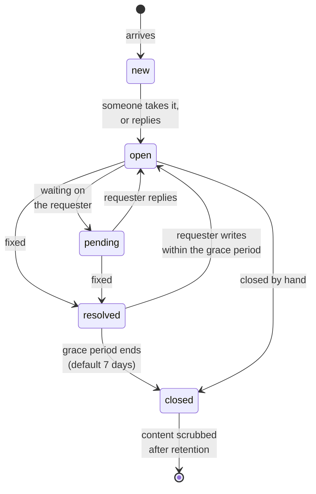
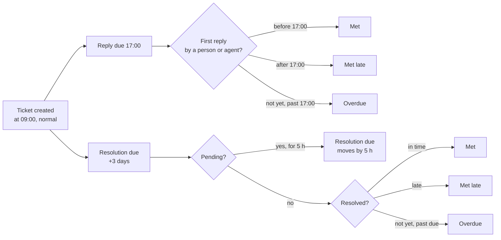
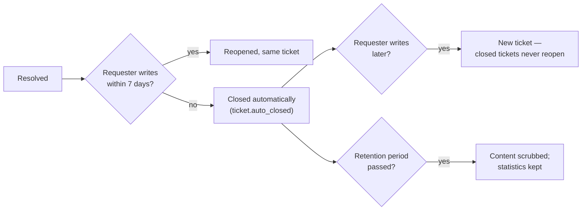

# Ticket lifecycle

## States

| State | Meaning | Who moves it here | The clocks |
|---|---|---|---|
| **New** | Nobody has touched it | Zentral, on arrival | Both running |
| **Open** | Being worked | An agent (assigning or replying), or the requester (replying) | Both running |
| **Pending** | The desk is waiting for the requester | An agent | Resolution clock **paused** |
| **Resolved** | Fixed, but the requester can still say "it isn't" | An agent | Stopped; result recorded |
| **Closed** | Finished; a new message starts a new ticket | Zentral after the grace period, or an agent | Stopped |

## Targets

Every ticket makes two promises, set by its priority.

| Priority | First reply | Resolution |
|---|---|---|
| Urgent | 1 hour | 8 hours |
| High | 4 hours | 1 day |
| Normal | 8 hours | 3 days |
| Low | 1 day | 7 days |

These are the defaults (calendar hours); set your own with
`ZENTRAL_SLA_RESPONSE_HOURS` and `ZENTRAL_SLA_RESOLVE_HOURS`, e.g.
`urgent=0.5,high=2,normal=8`. A priority left out has no target.

The rules behind it:

- **Only a real reply counts.** An agent's or AI agent's reply to the requester
  meets the first-reply target. An internal note does not; neither does the
  automatic acknowledgement.
- **Waiting on the requester pauses the resolution clock**, and the paused time
  is added to the deadline when the ticket becomes active again — whether an
  agent reopens it or the requester replies.
- **Changing the priority re-plans both targets from the creation time.** Raising
  a ticket to urgent can make it overdue immediately; that is deliberate.
- **Internal tickets** (no requester) have no first-reply target.

Where people see it:

| Where | What |
|---|---|
| Inbox, *Overdue* card | Count and filter of active tickets past a target |
| Inbox, *Due* column | The next promise: "Reply in 40m", "Resolve in 2d", "Waiting on requester", "Reply overdue · 2h ago" |
| Ticket, *Targets* panel | Both targets, their state and exact times |
| Insights | Share met on time, medians, trend |

## Closing

The grace period is `ZENTRAL_AUTO_CLOSE_DAYS` (default 7; 0 turns automatic
closing off). It runs with the six-hourly housekeeping job, together with
[retention](data.md#retention).

## Who owns a ticket

| Phase | Owner | Can see it |
|---|---|---|
| Untriaged | Triage (agents with `ticket:triage`) | Agents, admins, privacy officers, AI agents |
| In a team | The team | That team's members, its assignee, admins, privacy officers |
| Assigned | The assignee, on behalf of the team | As above; the assignee keeps access even if it is re-routed |
| Resolved, closed | The team | As above |
| Scrubbed | Nobody — only statistics remain | As above, without content |

## Outcome

A resolved and eventually closed ticket, a requester who got an answer, an
honest record of whether it happened in time, and — after the retention
period — no personal data left behind.
