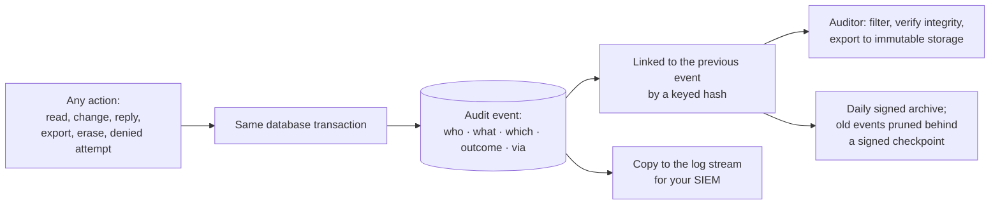

# Oversight and learning

## Oversight: evidence that everything was legitimate

| Question an auditor asks | Where the answer is |
|---|---|
| Who read this person's tickets? | Audit trail, `ticket.read` by resource |
| Did anyone try something they may not do? | Audit trail, outcome *denied* |
| What did the AI agent do? | Audit trail, *via* `mcp` |
| Was anything changed after the fact? | *Verify integrity* — any edit breaks the chain |
| Where are last year's events? | Signed archives; `audit.pruned` and the checkpoints say which range went where ([runbook](../runbooks/audit-verification.md#archive-and-prune-keep-the-database-lean)) |
| Who changed the configuration? | `source.*`, `rule.*`, `team.*`, `system.*` events |

Owner: the **auditor** (`audit:read`), who sees no ticket content. Details in
[Logging and audit](../compliance/logging.md).

## Insights

**What comes in:** nothing new — Insights reads the tickets the viewer may
already see, and returns only counts, medians and rates.

**Why:** a service desk improves by knowing where work comes from and whether
it keeps its promises.

| Figure | Meaning |
|---|---|
| Received / Resolved | Tickets created / resolved in the period |
| Open now | Active tickets, with how many are overdue |
| Waiting on requester | Pending tickets — their resolution clock is paused |
| Median first reply | From arrival to the first real reply |
| Median time to resolve | From arrival to resolution, waiting time excluded |
| Replied / Resolved on time | Share of measured targets met |
| By system, category, channel, priority | Where the work comes from |

**Who owns it:** team leads and admins act on it. Everyone with `ticket:read`
can open it and sees *their own scope* — a team sees its team, an admin sees
everything. AI agents can read the same figures through the `get_insights`
MCP tool.

**Outcome:** decisions grounded in numbers — which system needs fixing, which
team needs help, whether a target is realistic.
