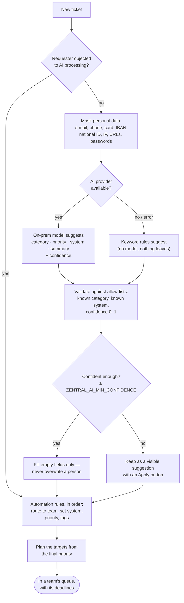

# Triage: making sense of a new ticket

## What comes in, and why

A freshly stored ticket, usually with nothing but a subject, a body and a
channel. Triage answers four questions so the right person sees it quickly:
*what kind of problem is it* (category), *how pressing* (priority), *which
system* and *which team*.

## What happens

### Who owns each decision

| Decision | Made by | Can be changed by | Recorded as |
|---|---|---|---|
| Whether a model is used at all | The requester, through the privacy officer (objection, Art. 21) | Privacy officer | `ticket.classification_skipped`, `privacy.ai_objection_recorded` |
| What the model may see | Zentral (masking is on by default; mandatory for cloud models in production) | Deployment configuration | `input_redacted` on `ticket.classified` |
| Which model | Deployment configuration | Platform owner | `provider`, `model`, `on_prem` |
| Suggested labels | The model — an *advisor* | Any agent, at any time | `ticket.classified` |
| Routing | Automation rules — deterministic, written by an admin | Admin; agents by re-routing | `automation.rule_applied` |
| Targets | Priority × configured hours | Changing the priority re-plans them | Visible on the ticket |

The model has no tools and cannot act. A hostile message can at worst cause a
wrong label, which a person sees and corrects. See [AI pipeline](../architecture/ai.md).

## Outcome

A ticket in a team's queue, with a category, a priority, usually a system, an
AI summary, and two deadlines: the first reply and the resolution. The inbox
shows it in the *Active* view, and in *Unassigned* until someone takes it.
