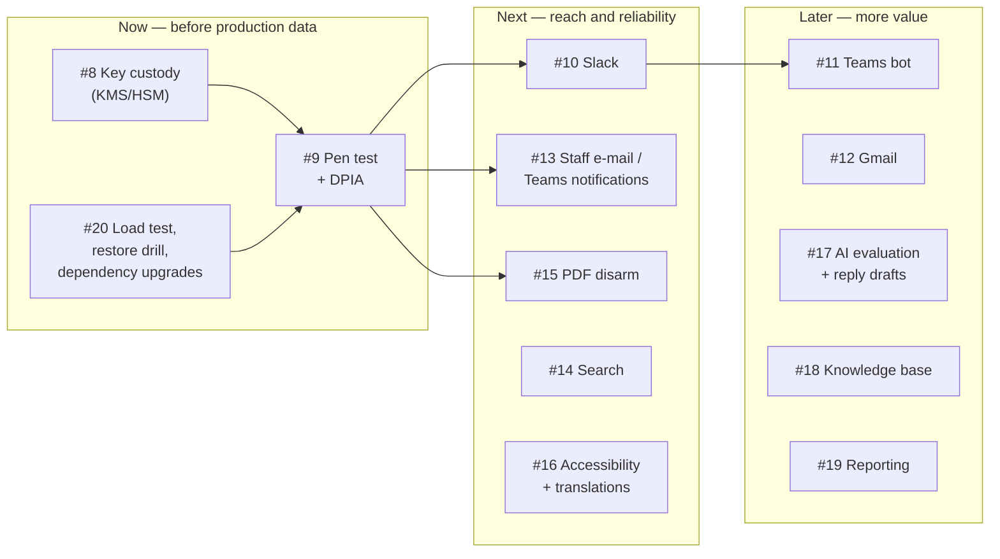

# Roadmap

Where Zentral stands, and what to do next — in the order we recommend. Every
item is a GitHub issue with a priority label; this page explains the order.

**P1** must happen before Zentral holds real personal data in production ·
**P2** next, as capacity allows · **P3** valuable, not urgent.

## Where it stands

Built and tested (≈400 backend tests on SQLite and PostgreSQL, a browser
walkthrough of every role, strict docs build):

- Intake from e-mail (Microsoft 365, mailbox-scoped), Teams, webhooks, the
  requester portal and AI agents (MCP); acknowledgements; attachments with
  malware scanning.
- Triage with on-prem-capable AI on masked text, rules, systems catalogue.
- Working tickets: targets on working hours, notifications and escalation,
  saved replies, merging, files both ways, Insights with satisfaction.
- Governance: Entra ID / OIDC, role- and team-based access, encryption at
  rest, hash-chained audit trail with signed archiving, GDPR access, erasure,
  retention and objection to AI processing.
- How it all fits together: [How it works](processes/index.md).

## Recommended next steps

### 1. Make it safe to go live (P1)

| Issue | Why first |
|---|---|
| [#8 Hardware-backed key custody](https://github.com/rogvid/zentral/issues/8) | The largest residual risk in the [threat model](architecture/threat-model.md): keys in environment variables mean a compromised host exposes all data |
| [#20 Load test, restore drill, dependency upgrades](https://github.com/rogvid/zentral/issues/20) | Proves capacity and recovery before anyone depends on it; clears the open Dependabot PRs |
| [#9 Independent security review, pen test and DPIA](https://github.com/rogvid/zentral/issues/9) | The precondition for handling private data. Do it after #8 and #20 so testers see the production shape |

### 2. Reach people where they are (P1–P2)

| Issue | Why |
|---|---|
| [#10 Slack connector](https://github.com/rogvid/zentral/issues/10) | In the original brief; the connector plug-in model makes it a contained piece of work |
| [#13 Staff notifications by e-mail and Teams](https://github.com/rogvid/zentral/issues/13) | Escalations only help if they reach people who are not looking at Zentral |
| [#15 PDF content disarm, second scanner](https://github.com/rogvid/zentral/issues/15) | Closes the remaining attachment risk |
| [#14 Search beyond 1,000 tickets](https://github.com/rogvid/zentral/issues/14) | Becomes noticeable after a few months of use; needs a careful privacy design |
| [#16 Accessibility audit and translations](https://github.com/rogvid/zentral/issues/16) | Requesters are the public; the portal must work for everyone, in their language |

### 3. More value (P2–P3)

| Issue | Why |
|---|---|
| [#11 Teams bot](https://github.com/rogvid/zentral/issues/11) | Files and 1:1 chats in Teams — the current webhook cannot receive files |
| [#12 Gmail connector](https://github.com/rogvid/zentral/issues/12) | For Google Workspace organisations |
| [#17 AI evaluation and reviewed reply drafts](https://github.com/rogvid/zentral/issues/17) | Evidence for choosing the on-prem model; faster answers without letting AI act |
| [#18 Knowledge base in the portal](https://github.com/rogvid/zentral/issues/18) | Answers before tickets |
| [#19 Insights export, per-team calendars](https://github.com/rogvid/zentral/issues/19) | Reporting for team leads; desks with different hours |

## How we work

- One issue, one branch, one pull request; CI (lint, types, security audit,
  tests on SQLite and PostgreSQL, web build, docs) must be green, and the
  browser walkthrough must pass.
- Every feature updates its process map in [How it works](processes/index.md),
  the [user stories](processes/user-stories.md), and — if it touches personal
  data — the [data map](processes/data.md) and the threat model.
