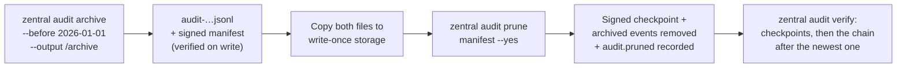

# Verify the audit trail

## Routine verification (daily)

```bash
zentral audit verify
# OK: 48211 events verified            → exit code 0
# TAMPERING DETECTED at seq 30122      → exit code 1
```

Schedule it and alert on a non-zero exit code.

=== "cron (Compose host)"

    ```cron
    15 3 * * *  cd /opt/zentral/deploy/compose && docker compose run --rm -T api audit verify || echo "ZENTRAL AUDIT VERIFY FAILED" | mail -s "Zentral audit alert" security@example.com
    ```

=== "Kubernetes CronJob"

    ```yaml
    apiVersion: batch/v1
    kind: CronJob
    metadata: { name: zentral-audit-verify, namespace: zentral }
    spec:
      schedule: "15 3 * * *"
      jobTemplate:
        spec:
          backoffLimit: 0
          template:
            metadata:
              labels: { "zentral.dev/db-client": "true" }
            spec:
              restartPolicy: Never
              automountServiceAccountToken: false
              securityContext: { runAsNonRoot: true, runAsUser: 10001, seccompProfile: { type: RuntimeDefault } }
              containers:
                - name: verify
                  image: zentral
                  args: ["audit", "verify"]
                  envFrom:
                    - configMapRef: { name: zentral-config }
                    - secretRef: { name: zentral-secrets }
                  securityContext: { allowPrivilegeEscalation: false, readOnlyRootFilesystem: true, capabilities: { drop: [ALL] } }
    ```

    Alert on failed Jobs with your cluster monitoring.

Auditors can run the same check from the web client (*Audit trail → Verify
integrity*).

## What verification proves — and what it does not

**Proves:** no stored event was modified, removed or reordered, and the
sequence has no gaps, since the first event — by anyone who does not hold the
audit key.

**Does not prove:**

- that the *most recent* events were not cut off the end (truncation). Detect
  this by comparing the highest sequence number with your SIEM copy or the last
  export — it must never go down;
- anything about actions taken outside Zentral (direct database access).

## Export and archive (monthly)

The trail grows indefinitely inside the database. Keep an independent,
write-once copy:

```bash
zentral audit export "audit-$(date -u +%Y%m).jsonl" --after-seq <last exported seq>
sha256sum audit-*.jsonl >> audit-manifest.sha256
```

Each line is one event including `hash` and `prev_hash`, so the export is
self-verifying. Store it in immutable storage (object lock / WORM), separate
from the database and its backups, for the period your policy requires.

Events are also mirrored to the application log in real time
(`logger: zentral.audit`); shipping those to a SIEM gives you a second,
continuously updated copy.

## Archive and prune (keep the database lean)

The trail only grows (roughly 0.5 kB per event). To move old events out of the
database **without losing the proof**, archive them to signed files and then
prune — two separate, deliberate steps:



```bash
zentral audit archive --before 2026-01-01 --output /mnt/audit-archive
# archived events 1-48211 (48211) to /mnt/audit-archive/audit-0000000001-0000048211.jsonl
zentral audit verify-archive /mnt/audit-archive/audit-0000000001-0000048211.manifest.json
# … copy both files to WORM storage …
zentral audit prune /mnt/audit-archive/audit-0000000001-0000048211.manifest.json --yes
```

What protects this:

- `archive` refuses to run if the chain does not verify, never overwrites an
  archive, and re-reads what it wrote before reporting success. The manifest
  records the range, the hashes at both ends and the file's SHA-256, and is
  signed with the audit key.
- `prune` verifies the archive again, checks that its last event is
  byte-for-byte the event in the database, and only then — in one transaction —
  writes a **signed checkpoint**, removes exactly that range, and records
  `audit.pruned` in the live chain. Archives must be pruned in order.
- The database guard permits that delete and nothing else: only inside a
  transaction that declared it, only up to an existing checkpoint. Checkpoints
  can never be changed or removed.
- `verify` checks that the checkpoints form their own signed chain and resumes
  the event chain after the newest one. Removing events without a valid
  checkpoint — or forging one without the audit key — is reported as tampering.

Keep the audit key (and retired keys in `ZENTRAL_AUDIT_HMAC_PREVIOUS_KEYS`) for
as long as you keep archives: it is what makes them verifiable.

### Automatically

Set `ZENTRAL_AUDIT_ARCHIVE_DIR` to a directory on write-once storage and the
worker writes a signed archive of everything before today, once a day. Add
`ZENTRAL_AUDIT_KEEP_DAYS` (e.g. `400`) and it also prunes archives whose newest
event is older than that. Without `KEEP_DAYS`, nothing is ever removed from the
database.

## "Tampering detected at event #N"

Treat as a **security incident**. Do not try to repair anything.

1. Note N and the time. Preserve state: take a database snapshot and export
   the trail (`zentral audit export`).
2. Rule out the benign cause — a wrong or rotated audit key. This shows as a
   failure at **event 1**:

    | First bad event | Likely cause |
    |---|---|
    | 1 | Wrong `ZENTRAL_AUDIT_HMAC_KEY`, or a rotated key not listed in `ZENTRAL_AUDIT_HMAC_PREVIOUS_KEYS`; or a restore from another installation |
    | N > 1 | Event N or its neighbourhood was altered or removed |

3. If N > 1: events before N are trustworthy. Compare events from N onwards
   with your archive / SIEM copy to see what changed:

    ```bash
    zentral audit export current.jsonl
    diff <(jq -c 'del(.hash)' archive.jsonl) <(jq -c 'del(.hash)' current.jsonl) | head
    ```

4. Continue with the [security incident runbook](security-incident.md):
   someone had write access to the database.
