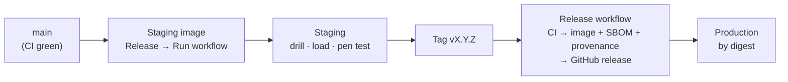

# Release, staging and go-live

How a version of Zentral goes from `main` to production: build once, prove it
on staging, promote **the same image digest**.



## Gates

A version goes to production only when all of these hold. Record the evidence
(links, dates) in the release's tracking issue.

| Gate | Evidence |
|---|---|
| CI green on the release commit: lint, types, security lint, tests on SQLite **and PostgreSQL**, dependency audits, web build, **browser end-to-end**, docs, image smoke test | The CI run; ideally enforced by branch protection on `main` |
| Staging runs the release image, in production shape | `zentral doctor` on staging: all ✓ (identity provider and key custody included) |
| Restore drill passed on staging, with the escrow check | `scripts/restore_drill.py` report |
| Load test on staging within the [sizing](../operations/sizing.md) targets | `scripts/loadtest.py` report (development-mode instance with staging's sizing) |
| First production release only: **independent penetration test**, high and critical findings fixed and re-tested | Report; [brief](../compliance/pentest-brief.md) |
| First production release only: **DPIA signed off** | [DPIA](../compliance/dpia.md) |
| Upgrading notes in `CHANGELOG.md` read and planned for | The upgrade plan |

## Staging

Staging is a separate installation with the production configuration and
**no real personal data**:

- Same image (by digest), same manifests, `ZENTRAL_ENV=production`,
  development sign-in off.
- Its **own** identity tenant or app registrations, its **own** KMS key and
  keyring, its own database. Nothing shared with production — a staging
  compromise must not reach production data or keys.
- Synthetic data only. Restoring a production backup into staging copies
  personal data into a less-protected place: don't.
- The attachment scanner, portal and every channel you use in production
  turned on, pointed at test mailboxes and test Teams channels.

Publish a staging image from `main` (or a release branch): **Actions →
Release → Run workflow**. It runs the full CI, then pushes
`ghcr.io/rogvid/zentral:staging` and `:sha-<commit>`. Deploy the digest from
the workflow summary, then:

```bash
kubectl -n zentral-staging exec deploy/zentral-api -- zentral doctor
python scripts/restore_drill.py "postgresql://…/zentral" \
  --escrow-keyring /media/escrow/keyring-escrow.json --escrow-kek /media/escrow/zentral-escrow.kek
```

## Cut the release

1. On `main`, move the changes from the top of `CHANGELOG.md` into a
   `## [X.Y.Z]` section with an **Upgrading** part for anything an operator
   must do. Set `version` in `pyproject.toml`, `__version__` in
   `src/zentral/__init__.py`, `web/package.json`, and `newTag` in
   `deploy/kubernetes/base/kustomization.yaml`; run `uv lock`. Merge.
2. Tag the merge commit and push the tag:

    ```bash
    git tag -s vX.Y.Z -m "Zentral X.Y.Z" && git push origin vX.Y.Z
    ```

3. The **Release** workflow runs CI again, refuses a tag that does not match
   `pyproject.toml` or has no changelog section, publishes
   `ghcr.io/rogvid/zentral:X.Y.Z` (and `X.Y`) with an SBOM and signed
   provenance, smoke-tests the published image, and creates the GitHub release
   with the notes, the image digest and the Python package. A version with a
   suffix (`1.1.0-rc.1`) becomes a pre-release.

## Go live / promote

1. Verify the image:

    ```bash
    gh attestation verify oci://ghcr.io/rogvid/zentral@sha256:<digest> -R rogvid/zentral
    ```

2. Follow the [upgrade runbook](upgrade.md) (backup first) with the image
   **pinned by digest**.
3. `zentral doctor`, `zentral audit verify`, sign in, open a ticket.
4. Watch the first hours with [Monitoring](../operations/monitoring.md).

Roll back with the [upgrade runbook](upgrade.md#roll-back): the previous
digest, and the database backup if a migration ran.
